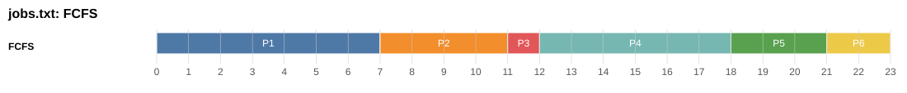
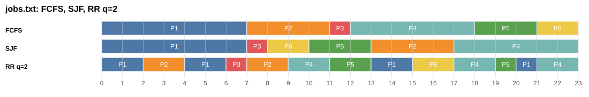
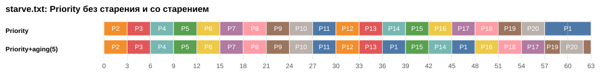
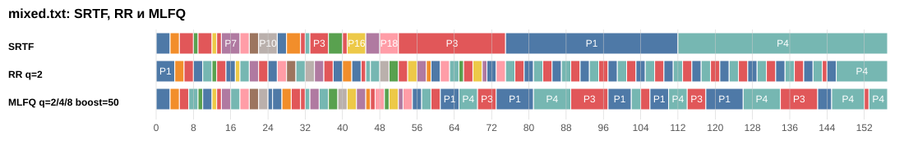

# Модуль 1. Проект 1: планировщик учебного сервера

**Дисциплина:** Проектирование операционных систем, Модуль 1 (РК-1)
**Номер проекта:** 1

## Участники

| Участник | Уровень | Блоки | Что сделал |
| --- | --- | --- | --- |
| Эркинбеков Айман | C (продвинутый) | A, B, C | весь код, отчёт, презентация |

Каждый файл подписан автором в первых строках.

## Задача

Заказчик: администратор сервера колледжа. Студенты запускают на сервере долгие расчёты и короткие интерактивные запросы. Нужно, чтобы короткие запросы не ждали за длинными, но и длинные задачи когда-нибудь завершались.

Нужно сравнить алгоритмы планирования и дать заказчику рекомендацию с опорой на числа.

## Запуск

Нужен только Python 3.11 или новее. Внешние библиотеки не нужны.

```bash
./modul1/run.sh
```

Скрипт можно запускать из любой папки. Он делает самопроверку, считает все блоки и сохраняет вывод в `evidence/`, а отчёт и диаграммы Ганта в `results/`.

На чистой Ubuntu без Python сначала:

```bash
sudo apt update && sudo apt install -y python3
```

Отдельные команды, если нужно запустить что-то одно (из папки `modul1`):

```bash
python3 selfcheck.py                          # сверка с эталоном ПР-5
python3 report.py                             # отчёт по блокам A, B, C
python3 main.py data/jobs.txt all             # пять алгоритмов на jobs.txt
python3 main.py data/mixed.txt rr --q 2       # один алгоритм
python3 main.py data/starve.txt aging --step 5
python3 main.py data/mixed.txt mlfq --boost 50
```

## Файлы

| Файл | Что внутри |
| --- | --- |
| `run.sh` | запуск всего одной командой |
| `scheduler.py` | все алгоритмы: FCFS, SJF, RR, SRTF, Priority, Priority со старением, MLFQ |
| `main.py` | запуск одного алгоритма на одном файле |
| `report.py` | таблицы по блокам A, B, C и диаграммы Ганта |
| `selfcheck.py` | сверка set1.txt с эталоном ПР-5 и проверка корректности |
| `data/` | set1.txt, jobs.txt, mixed.txt, starve.txt |
| `evidence/` | вывод команд текстом |
| `results/` | `report.md` и диаграммы Ганта `gantt_*.svg` |
| `presentation.pptx` | презентация, 5 слайдов, заметки для выступления внутри |

## Правила (как в ПР-5)

- Строка файла: `PID arrival burst priority`. Строки с `#` пропускаются. Меньшее число priority значит более высокий приоритет.
- При равенстве первым идёт процесс, который пришёл раньше, потом процесс с меньшим номером PID.
- В SRTF и Priority при равенстве работающий процесс не вытесняется.
- В RR процесс, пришедший в момент окончания кванта, встаёт в очередь раньше вытесненного.
- Ожидание = оборот - burst. Оборот = завершение - приход. Отклик = первый запуск - приход.
- Переключение: процессор перешёл с одного процесса на другой.

---

## Блок A. Базовый

### A1. FCFS для jobs.txt



```text
|   P1  | P2 | P3|  P4  | P5| P6|
0       7   11  12     18  21  23
```

| PID | Приход | Burst | Старт | Конец | Ожидание | Оборот |
| --- | --: | --: | --: | --: | --: | --: |
| P1 | 0 | 7 | 0 | 7 | 0 | 7 |
| P2 | 2 | 4 | 7 | 11 | 5 | 9 |
| P3 | 3 | 1 | 11 | 12 | 8 | 9 |
| P4 | 5 | 6 | 12 | 18 | 7 | 13 |
| P5 | 6 | 3 | 18 | 21 | 12 | 15 |
| P6 | 8 | 2 | 21 | 23 | 13 | 15 |
| Среднее | | | | | 7,5 | 11,33 |

Расчёт вручную совпал с программой (`python3 main.py data/jobs.txt fcfs`).

### A2. FCFS, SJF и RR q=2 для jobs.txt

Диаграммы Ганта и таблицы по каждому процессу: [results/report.md](results/report.md) и [evidence/jobs_all.txt](evidence/jobs_all.txt).

### A3. Самопроверка на set1.txt

Все пять алгоритмов совпали с эталоном ПР-5 (вывод: [evidence/selfcheck.txt](evidence/selfcheck.txt)).

| Алгоритм | Ожидание | Эталон | Оборот | Эталон |
| --- | --: | --: | --: | --: |
| FCFS | 8,75 | 8,75 | 15,25 | 15,25 |
| SJF | 7,75 | 7,75 | 14,25 | 14,25 |
| SRTF | 6,5 | 6,5 | 13 | 13 |
| Priority | 10,75 | 10,75 | 17,25 | 17,25 |
| RR q=3 | 13,5 | 13,5 | 20 | 20 |

Ещё `selfcheck.py` проверяет все алгоритмы на всех четырёх файлах: каждый процесс отработал ровно свой burst и не стартовал раньше прихода.

### A4. Какой алгоритм лучше для jobs.txt

| Алгоритм | Ср. ожидание | Ср. оборот |
| --- | --: | --: |
| FCFS | 7,5 | 11,33 |
| SJF | 5,17 | 9 |
| RR q=2 | 8,33 | 12,17 |



Лучший SJF. Он пропускает вперёд короткие P3 (burst 1) и P6 (burst 2), и они не стоят за длинными. В FCFS короткий P6 ждёт 13 единиц только потому, что пришёл последним. RR q=2 хуже всех по ожиданию, но у него лучший отклик (3,17).

---

## Блок B. Основной

### B1. SRTF и Priority на jobs.txt

| Алгоритм | Ср. ожидание | Ср. оборот | Ср. отклик | Переключений |
| --- | --: | --: | --: | --: |
| FCFS | 7,5 | 11,33 | 7,5 | 5 |
| SJF | 5,17 | 9 | 5,17 | 5 |
| RR q=2 | 8,33 | 12,17 | 3,17 | 12 |
| SRTF | 4,33 | 8,17 | 2,5 | 7 |
| Priority | 7,5 | 11,33 | 5,17 | 7 |

### B2. Все 5 алгоритмов на mixed.txt

Длинные задачи: P1 (40), P3 (35), P4 (45). Остальные 15 короткие (burst от 1 до 4).

| Алгоритм | Ср. ожидание | Ср. отклик | Переключений | Ожидание коротких (ср.) | Ожидание коротких (макс.) | Конец P1, P3, P4 |
| --- | --: | --: | --: | --: | --: | --: |
| FCFS | 93,28 | 93,28 | 17 | 104,67 | 114 | 40, 77, 122 |
| SJF | 32,67 | 32,67 | 17 | 27,27 | 47 | 40, 112, 157 |
| RR q=2 | 30,83 | 8,61 | 76 | 15,87 | 30 | 146, 144, 157 |
| SRTF | 12,28 | 6,33 | 23 | 0,47 | 3 | 112, 75, 157 |
| Priority | 13 | 10,83 | 24 | 0,53 | 3 | 77, 157, 122 |

- FCFS хуже всех: короткий запрос ждёт в среднем 105 единиц за длинными расчётами.
- SJF без вытеснения: короткий запрос всё равно ждёт, пока закончится уже запущенный длинный.
- SRTF даёт лучшие числа, но ему надо заранее знать длительность задачи. На настоящем сервере её никто не знает.
- Priority здесь хорош случайно: коротким задачам в файле дали высокий приоритет. В блоке C видно, что он может морить задачи голодом.

### B3. RR на mixed.txt при кванте от 1 до 10

| Квант | Ср. ожидание | Ср. отклик | Переключений | Ожидание коротких |
| --: | --: | --: | --: | --: |
| 1 | 29,78 | 4,39 | 145 | 14,67 |
| **2** | **30,83** | **8,61** | **76** | **15,87** |
| 3 | 33,28 | 12,33 | 57 | 18,87 |
| 4 | 32,5 | 15,78 | 42 | 18,27 |
| 5 | 35,61 | 19,39 | 36 | 22,33 |
| 6 | 37,39 | 21,33 | 33 | 24,4 |
| 7 | 41,11 | 24,78 | 31 | 28,73 |
| 8 | 42,78 | 26,44 | 29 | 30,53 |
| 9 | 45,89 | 29,83 | 28 | 34,4 |
| 10 | 47 | 31,33 | 26 | 36 |

Чем больше квант, тем хуже отклик и ожидание, но меньше переключений. При очень большом кванте RR становится похож на FCFS.

### B4. Рекомендация заказчику

Из пяти алгоритмов: Round Robin с квантом 2.

1. RR не нужно знать длительность задач, и никто не голодает: все длинные расчёты завершились.
2. Квант 1 даёт отклик лучше (4,39 против 8,61), но переключений почти в 2 раза больше (145 против 76). Каждое переключение тратит время процессора.
3. С квантом 4 и больше короткие запросы ждут заметно дольше, отклик от 15,78.

Ещё лучше для заказчика MLFQ из блока C.

---

## Блок C. Продвинутый

### C1. Голодание в Priority на starve.txt

P1 (приоритет 9, burst 6) пришёл в момент 0, но стартует только в **57** и заканчивает в **63**. Всё это время процессор заняли 19 задач с приоритетом от 1 до 3, которые приходят каждые 3 единицы.

```text
P2[0-3] P3[3-6] P4[6-9] ... P19[51-54] P20[54-57] P1[57-63]
```

### C2. Старение

Правило как в ПР-5: если процесс ждёт в очереди N тактов подряд, его приоритет улучшается на 1. Когда процесс получил процессор, счётчик сбрасывается.

| Шаг N | Старт P1 | Конец P1 | Раньше на | Ср. ожидание всех |
| --- | --: | --: | --: | --: |
| без старения | 57 | 63 | 0 | 2,85 |
| 2 | 18 | 27 | 39 | 4,95 |
| 3 | 21 | 27 | 36 | 4,65 |
| **5** | **36** | **48** | **21** | 4 |
| 8 | 51 | 63 | 6 | 3,25 |
| 10 | 57 | 63 | 0 | 2,85 |

При шаге 5 P1 стартует в 36 вместо 57, то есть на 21 единицу раньше. Чем меньше шаг, тем раньше стартует P1, но тем дольше ждут остальные. При шаге 10 старение не успевает помочь.



### C3. MLFQ

Настройки: 3 уровня с квантами 2, 4 и 8. Новый процесс попадает на верхний уровень. Если процесс потратил весь квант, он опускается на уровень ниже. Процесс с верхнего уровня сразу вытесняет процесс с нижнего. Каждые 50 единиц boost поднимает все процессы наверх.

| Алгоритм | Ср. ожидание | Ср. отклик | Переключений | Ожидание коротких (ср.) | Ожидание коротких (макс.) | Конец P1, P3, P4 |
| --- | --: | --: | --: | --: | --: | --: |
| SRTF | 12,28 | 6,33 | 23 | 0,47 | 3 | 112, 75, 157 |
| RR q=2 | 30,83 | 8,61 | 76 | 15,87 | 30 | 146, 144, 157 |
| MLFQ | 22,44 | 0,28 | 53 | 5,27 | 17 | 145, 153, 157 |



- У MLFQ лучший отклик из всех алгоритмов: 0,28. Новый запрос почти сразу получает процессор.
- Короткие запросы ждут в среднем 5,27, это в 3 раза меньше, чем в RR q=2. Переключений тоже меньше: 53 против 76.
- SRTF немного лучше по ожиданию, но ему нужно знать длительность заранее. MLFQ получает близкий результат без этого.
- Длинные расчёты не голодают и завершаются.

Boost с периодом 20 или 30 слишком часто поднимает длинные задачи наверх, и короткие начинают ждать дольше (до 9,4). Период 50 не мешает коротким и при этом не даёт длинным застрять. Все варианты в [results/report.md](results/report.md).

### C4. Почему MLFQ работает без знания длительности задач

MLFQ не спрашивает, сколько будет работать задача. Он смотрит, как она себя ведёт:

1. Каждый новый процесс сначала считается коротким и попадает наверх, где квант маленький.
2. Короткий запрос успевает закончиться за первый квант, как в SJF.
3. Длинный расчёт тратит квант целиком и опускается ниже, где квант больше и переключений меньше.
4. Получается, что очередь сама делит задачи на короткие и длинные по их прошлому поведению.
5. Boost периодически поднимает всех наверх, поэтому длинные задачи не голодают.

---

## Выводы

1. Для заказчика лучше всего подходит **MLFQ**: 3 уровня, кванты 2, 4, 8, boost каждые 50. Отклик 0,28, короткие ждут в 3 раза меньше, чем в RR, длинные задачи завершаются.
2. Если нужен простой алгоритм, подойдёт **RR с квантом 2**. Квант 1 даёт почти в 2 раза больше переключений, квант 4 и больше заметно хуже для коротких запросов.
3. SRTF лучший по числам, но на практике его не применить: длительность задач заранее неизвестна.
4. Priority без старения опасен: на starve.txt процесс P1 ждал 57 единиц. Старение с шагом 5 сокращает ожидание до 36.
5. FCFS для смешанной нагрузки не подходит: короткие запросы ждут больше 100 единиц.

| | FCFS | RR q=2 | SRTF | MLFQ |
| --- | :-: | :-: | :-: | :-: |
| Короткие не ждут за длинными | нет | частично | да | да |
| Длинные задачи завершаются | да | да | да | да |
| Не нужно знать длительность | да | да | нет | да |

## Презентация

Файл: [presentation.pptx](presentation.pptx).
