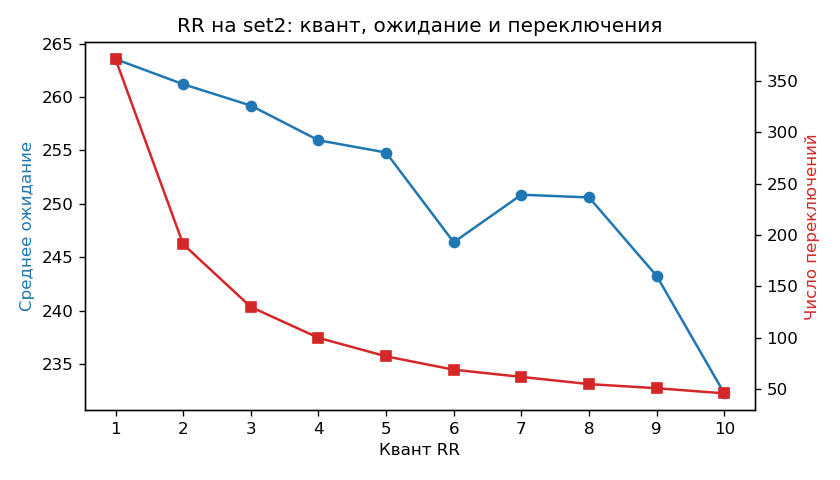

# ПР-5. Симулятор планирования CPU

**Автор:** Эркинбеков Айман · **Дисциплина:** Операционные системы · **Вариант:** B

## Тема и цель

Реализовать классические алгоритмы планирования процессора: FCFS, SJF, SRTF,
Priority (вытесняющий) и Round Robin, и сравнить их по метрикам на одних и тех
же наборах процессов. Сверить результаты с эталоном методички.

## Что сделано и как это работает

Симулятор `sched.py` «проигрывает» работу процессора по тактам и строит
диаграмму Ганта: список отрезков `(процесс, начало, конец)`. Все алгоритмы
вызываются через одну функцию `simulate(processes, algorithm, **params)`.

| Алгоритм | Кого выбирает | Вытесняет? |
| --- | --- | --- |
| FCFS | кто раньше пришёл | нет |
| SJF | у кого короче burst | нет |
| SRTF | у кого меньше осталось работать | да, если пришёл процесс со строго меньшим остатком |
| Priority | у кого выше приоритет (меньше число) | да, если пришёл процесс со строго более высоким приоритетом |
| RR | по очереди, каждому квант времени | да, по окончании кванта |

**Соглашения из методички:**

- при равенстве критерия первым идёт процесс, пришедший раньше, а при равном
  приходе: с меньшим номером PID (сравнивается номер, поэтому `P2` раньше `P10`);
- в SRTF и Priority при равенстве работающий процесс не вытесняется;
- в RR процесс, пришедший в момент t, встаёт в очередь **раньше** процесса,
  вытесненного в тот же момент t.

**Метрики:**

- оборот = завершение − приход;
- ожидание = оборот − burst (время в очереди готовых, а не «завершение − приход»);
- отклик = первый запуск − приход;
- загрузка CPU = сумма burst / (последнее завершение − первый приход);
- переключение = смена процесса между соседними отрезками диаграммы.

**Старение (aging)** в Priority: каждые N тактов ожидания приоритет процесса
улучшается на 1, и улучшение сохраняется до конца процесса.

**Входные данные.** `set1.txt`, `set2.txt`, `set3.txt` переписаны из методички
без изменений (их создаёт `gen_sets.py`). Формат строки: `PID приход burst приоритет`,
первая строка: комментарий `#`. `starve.txt`: свой набор для демонстрации
голодания: процесс `LOW` с приоритетом 9 и 30 важных процессов `H01…H30`
с приоритетом 1, которые приходят каждые 2 такта.

## Файлы

| Файл | За что отвечает |
| --- | --- |
| `README.md` | Отчёт |
| `run.sh` | Вся работа одной командой |
| `sched.py` | Симулятор: чтение файла, 5 алгоритмов, метрики, диаграмма Ганта, командная строка |
| `gen_sets.py` | Создаёт `set1.txt`, `set2.txt`, `set3.txt` (данные методички) и `starve.txt` |
| `check_set1.py` | Сверка всех 5 алгоритмов на `set1` с эталоном методички |
| `compare.py` | Таблицы сравнения алгоритмов на трёх наборах |
| `rr_quantum.py` | RR с квантом 1…10 на `set2`: таблица, текстовый график и `rr_quantum.png` |
| `set1.txt` | Контрольный набор, 4 процесса |
| `set2.txt` | 20 процессов с длинными burst (CPU-bound) |
| `set3.txt` | Один длинный процесс (burst 60) и 19 коротких |
| `starve.txt` | Набор, где без старения процесс `LOW` голодает |
| `rr_quantum.png` | График «квант → среднее ожидание и число переключений» |
| `evidence/check_set1.txt` | Вывод сверки с эталоном |
| `evidence/gantt_set1.txt` | Диаграммы Ганта SRTF и RR (q = 3) на `set1` |
| `evidence/compare.md` | Таблицы сравнения на трёх наборах |
| `evidence/rr_quantum.txt` | Вывод `rr_quantum.py` |
| `evidence/aging.txt` | Priority на `starve.txt` без старения и со старением |
| `evidence/generation.txt` | Вывод `gen_sets.py` |
| `evidence/environment.txt` | Где сняты результаты: Python, архитектура, ядра, система |
| `.gitignore` | Не добавлять в git `__pycache__/` и `out/` |

## Как запустить

Нужен `python3`; для PNG-графика: `python3-matplotlib`
(`sudo apt install -y python3 python3-matplotlib`). Без matplotlib всё работает,
кроме PNG.

```bash
./run.sh
```

Команда из требований методички:

```bash
python3 sched.py --algo rr --quantum 3 set1.txt
```

Другие варианты: `--algo fcfs|sjf|srtf|priority|rr`, `--quantum N` для RR,
`--aging N` для Priority, `--gantt`: напечатать диаграмму Ганта.

## Пример вывода и что он означает

Все результаты ниже сняты в Docker-контейнере Ubuntu 26.04.1 (Python 3.14.4,
aarch64). Симулятор детерминирован: на любой машине числа будут те же.

### Сверка с эталоном на set1

```text
FCFS      ожидание 8.75 (эталон 8.75), оборот 15.25 (эталон 15.25) OK
SJF       ожидание 7.75 (эталон 7.75), оборот 14.25 (эталон 14.25) OK
SRTF      ожидание 6.50 (эталон 6.50), оборот 13.00 (эталон 13.00) OK
Priority  ожидание 10.75 (эталон 10.75), оборот 17.25 (эталон 17.25) OK
RR, q=3   ожидание 13.50 (эталон 13.50), оборот 20.00 (эталон 20.00) OK
```

Все пять алгоритмов совпали с эталоном методички.

### Диаграммы Ганта на set1

```text
Алгоритм: SRTF
| P1 | P2 | P4 | P1 | P3 |
0    1    5    10   17   26

Алгоритм: RR (q=3)
| P1 | P2 | P3 | P4 | P1 | P2 | P3 | P4 | P1 | P3 |
0    3    6    9    12   15   16   19   21   23   26
```

В SRTF короткий P2 (burst 4) вытесняет P1 сразу после прихода, затем идёт P4,
и только потом P1 доделывает свои 7 тактов. В RR в момент 3 пришедший P4
встаёт в очередь раньше вытесненного P1, по соглашению методички. Полный вывод
с таблицами по процессам, в `evidence/gantt_set1.txt`.

### Сравнение алгоритмов

Priority: вытесняющий, без старения; RR: с квантом 3.

**set1** (4 процесса)

| Алгоритм | Среднее ожидание | Средний оборот | Среднее время отклика | Загрузка CPU, % | Переключения |
| --- | ---: | ---: | ---: | ---: | ---: |
| FCFS | 8.75 | 15.25 | 8.75 | 100.0 | 3 |
| SJF | 7.75 | 14.25 | 7.75 | 100.0 | 3 |
| SRTF | 6.50 | 13.00 | 4.25 | 100.0 | 4 |
| Priority | 10.75 | 17.25 | 8.50 | 100.0 | 4 |
| RR, q=3 | 13.50 | 20.00 | 3.00 | 100.0 | 9 |

**set2** (20 процессов, CPU-bound)

| Алгоритм | Среднее ожидание | Средний оборот | Среднее время отклика | Загрузка CPU, % | Переключения |
| --- | ---: | ---: | ---: | ---: | ---: |
| FCFS | 146.30 | 165.05 | 146.30 | 100.0 | 19 |
| SJF | 132.80 | 151.55 | 132.80 | 100.0 | 19 |
| SRTF | 132.80 | 151.55 | 132.80 | 100.0 | 19 |
| Priority | 150.25 | 169.00 | 144.40 | 100.0 | 21 |
| RR, q=3 | 259.20 | 277.95 | 26.95 | 100.0 | 130 |

**set3** (один длинный и 19 коротких)

| Алгоритм | Среднее ожидание | Средний оборот | Среднее время отклика | Загрузка CPU, % | Переключения |
| --- | ---: | ---: | ---: | ---: | ---: |
| FCFS | 62.25 | 68.00 | 62.25 | 100.0 | 19 |
| SJF | 58.00 | 63.75 | 58.00 | 100.0 | 19 |
| SRTF | 13.95 | 19.70 | 11.00 | 100.0 | 22 |
| Priority | 39.35 | 45.10 | 35.90 | 100.0 | 23 |
| RR, q=3 | 26.85 | 32.60 | 17.05 | 100.0 | 30 |

Загрузка CPU везде 100 %: процессор ни разу не простаивал.

**Что видно:**

- **set1.** Лучшее ожидание у SRTF (6.50): короткие процессы вытесняют длинные.
  У RR ожидание самое большое (13.50), зато лучший отклик (3.00): каждый
  процесс быстро получает процессор в первый раз. Priority здесь хуже FCFS,
  потому что самый важный процесс P3 ещё и самый длинный (burst 9).
- **set2.** Процессы длинные и похожие, поэтому SJF выигрывает у FCFS немного
  (132.80 против 146.30). SRTF совпал с SJF: новые процессы приходят не короче
  остатка того, кто уже работает, и вытеснений не случается. RR ухудшил
  ожидание почти вдвое (259.20): все процессы делят процессор и заканчиваются
  ближе к концу, но дал отклик 26.95 вместо 130-150 у остальных.
- **set3.** Лучший алгоритм: **SRTF** (ожидание 13.95 против 62.25 у FCFS).
  Длинный P1 приходит первым, и в FCFS и SJF занимает процессор на 60 тактов,
  а 19 коротких стоят за ним, эффект конвоя. SJF не вытесняет и потому почти
  не помогает (58.00). SRTF вытесняет P1, как только приходит короткий процесс.
  RR тоже хорош (26.85), и ему не нужно знать длину burst заранее. Priority
  оказался посередине (39.35): у P1 приоритет 12, и короткие процессы с более
  высоким приоритетом его вытесняют, но не все.

### RR: зависимость от кванта на set2

| Квант | Среднее ожидание | Переключений | Среднее время отклика |
| ---: | ---: | ---: | ---: |
| 1 | 263.55 | 371 | 8.55 |
| 2 | 261.20 | 191 | 17.45 |
| 3 | 259.20 | 130 | 26.95 |
| 4 | 255.95 | 100 | 35.45 |
| 5 | 254.80 | 82 | 44.60 |
| 6 | 246.40 | 69 | 53.40 |
| 7 | 250.85 | 62 | 61.60 |
| 8 | 250.60 | 55 | 70.45 |
| 9 | 243.25 | 51 | 78.30 |
| 10 | 232.25 | 46 | 85.05 |



Компромисс:

- чем меньше квант, тем быстрее процесс получает процессор впервые: отклик
  8.55 при q = 1 и 85.05 при q = 10;
- но тем больше переключений: 371 при q = 1 и 46 при q = 10. В симуляторе
  переключение бесплатно, а в настоящей ОС каждое отнимает время процессора;
- среднее ожидание меняется мало (263.55 → 232.25) и не строго монотонно:
  процессы длинные, и всё равно заканчиваются ближе к концу;
- при кванте, стремящемся к бесконечности, RR превращается в FCFS.

Квант выбирают так, чтобы отклик был приемлемым, а переключения не съедали
заметную долю процессора.

### Старение

```text
Без старения:
PID   приход  burst  prio  конец  ожидание  оборот  отклик
LOW        0      5     9     95        90      95       0
H30       60      3     1     92        29      32      29
Среднее ожидание: 16.94

Со старением:
PID   приход  burst  prio  конец  ожидание  оборот  отклик
LOW        0      5     9     68        63      68       0
H30       60      3     1     95        32      35      32
Среднее ожидание: 17.00
```

Без старения `LOW` ждёт 90 тактов и заканчивает последним (на 95-м), только
когда закончились все 30 важных процессов, это голодание. Со старением (`--aging 5`)
приоритет ждущего `LOW` постепенно растёт, и он заканчивает на 68-м такте.
Цена небольшая: последний важный процесс H30 ждёт 32 такта вместо 29.

## Контрольные вопросы

**Почему SJF нельзя применять в реальной ОС напрямую?** Для SJF нужно заранее
знать длину следующего CPU-burst, а ОС её не знает. На практике её только
предсказывают по прошлым burst (например, экспоненциальным средним). Кроме
того, длинные процессы могут голодать, пока приходят короткие.

**Что происходит при кванте RR, стремящемся к бесконечности?** Процесс всегда
успевает закончиться раньше конца кванта, вытеснений нет, процессы идут в
порядке прихода: RR превращается в FCFS.

## Выводы

- Симулятор совпал со всеми пятью эталонами методички на `set1`.
- Нет «лучшего вообще» алгоритма: SRTF лучший по ожиданию, RR лучший по отклику,
  FCFS прост, но страдает от эффекта конвоя (особенно на `set3`).
- Квант RR: компромисс между откликом и числом переключений.
- Старение устраняет голодание низкоприоритетных процессов почти без потерь
  для остальных.
