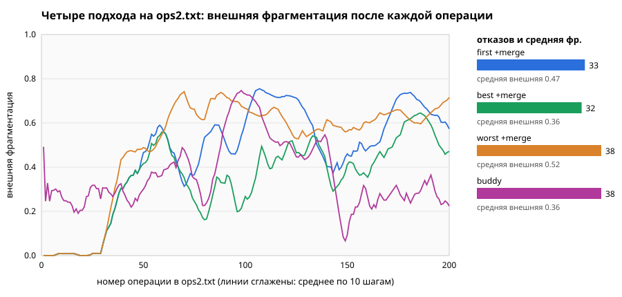

# ПР-9. Управление памятью

**Автор:** Эркинбеков Айман · **Дисциплина:** Операционные системы · **Вариант:** B (сделаны также уровни A и C)

## Цель работы

Написать симулятор динамического распределения памяти: стратегии first fit, best fit и worst fit, подсчёт фрагментации, склеивание соседних свободных дыр и buddy system. Потом сравнить четыре подхода на большом наборе из 200 операций. На уровне C написать свой аллокатор на C поверх одного mmap-региона (`my_malloc`, `my_free`, `my_realloc`) с двумя стратегиями, детектором утечек и use-after-free, и сравнить его с glibc malloc.

## Файлы

- `memsim.py` - класс `MemoryManager` (блоки, выбор дыры по стратегии, `alloc`, `free`, склейка дыр `merge`, карта памяти `show`, метрики `stats`), а также функции `load` (чтение файла операций) и `run` (прогон операций).
- `run_ops1.py` - прогон файла операций с картой памяти после каждой операции.
- `buddy.py` - класс `Buddy`: buddy system (блоки только степени двойки, склейка с "другом"), методы `alloc` и `release`.
- `compare.py` - сравнение first fit, best fit, worst fit (со склейкой) и buddy на `ops2.txt`.
- `ops1.txt` - контрольный набор из 12 операций (считается на бумаге).
- `ops2.txt` - большой набор из 200 операций (113 alloc и 87 free, размеры 8-298), получен скриптом `gen_ops2.py` из шаблона с `seed=42`.
- `ops1_table.py` - таблица "на каких операциях `ops1` отказ" для всех вариантов.
- `plot.py` - рисует график `fragmentation.svg` (без сторонних библиотек).
- `check_pr9.py` - проверки Python-части.
- `run.sh` - вся работа одной командой.
- `c/` - уровень C: `myalloc.h` и `myalloc.c` (аллокатор), `test_myalloc.c` (тесты), `bench.c` и `bench.sh` (сравнение с glibc), `bugs.c` (программа с намеренными ошибками для детектора и valgrind), `Makefile`.
- `evidence/` - вывод запусков.

Оба файла с данными и интерфейс (`load`, `run`, `Buddy`, `release`, `stats`) взяты из шаблона, поэтому вывод программ совпадает с ожидаемым в задании.

## Среда

- Ubuntu 26.04 в Docker-контейнере (`ubuntu:26.04`, arm64) на macOS. Весь вывод в `evidence/` снят в этом контейнере.
- Python, только стандартная библиотека. Для уровня C: gcc и valgrind.

Версия Python, архитектура, число ядер, система, gcc и valgrind:

```text
Python 3.14.4
aarch64
10
Ubuntu 26.04.1 LTS
gcc (Ubuntu 15.2.0-16ubuntu1) 15.2.0
valgrind-3.26.0
```

## Как запустить

Вся работа одной командой (для уровня C нужны `gcc` и `make`, `valgrind` по желанию):

```bash
./run.sh
```

По частям:

```bash
python3 run_ops1.py first
python3 run_ops1.py best
python3 run_ops1.py worst
python3 run_ops1.py first --coalesce
python3 run_ops1.py buddy
python3 ops1_table.py
python3 compare.py
python3 plot.py
./check_pr9.py
cd c
make
make test
make valgrind
./bench.sh
```

Из интерпретатора Python то же самое делается так:

```python
from memsim import *
mm = run(load("ops1.txt"), "first", coalesce=True, verbose=True)
```

## 1. Как устроена память

Вся память (1024 условные единицы) хранится как список блоков. У блока есть начало, размер и владелец (`pid`). Если `pid` равен `None`, блок свободен, и это дыра. В начале вся память одна дыра: `[-:1024]`.

- `alloc(pid, size)` выбирает дыру по стратегии. Дыра заменяется занятым блоком, а остаток (если он есть) становится новой дырой сразу за ним. Если подходящей дыры нет, запрос отклоняется, и счётчик отказов растёт на 1. Карта памяти при отказе не меняется.
- `free(pid)` только снимает владельца с блока. Соседние дыры остаются отдельными, пока склейка выключена.
- `merge()` склеивает соседние дыры в одну за один проход по списку: две свободные дыры подряд становятся одной, занятые блоки копируются как есть. Если создать `MemoryManager(strategy, coalesce=True)`, то она вызывается после каждого `free`.
- `show()` печатает карту: `[P1:200] [-:824]` значит, что у `P1` блок 200, дальше дыра 824.
- `stats()` возвращает три числа: сколько всего свободно, какая самая большая дыра и сколько дыр.

## 2. Три стратегии выбора дыры

Сначала собирается список подходящих дыр (`candidates`): свободные блоки, размер которых не меньше запроса. Дальше функция `choose` выбирает одну:

- **first fit** - первая подходящая по адресу;
- **best fit** - самая маленькая из подходящих (остаток получается минимальным);
- **worst fit** - самая большая из подходящих (надежда, что остаток будет ещё пригоден).

Если несколько дыр одинакового размера, берётся левая по адресу.

## 3. Контрольный набор ops1

Это 12 операций, которые считаются на бумаге. Вывод `first fit` совпадает с ожидаемым результатом из задания, это проверяет `check_pr9.py`:

```text
 1 alloc P1   200  [P1:200] [-:824]
 2 alloc P2   300  [P1:200] [P2:300] [-:524]
 3 alloc P3   150  [P1:200] [P2:300] [P3:150] [-:374]
 4 alloc P4   250  [P1:200] [P2:300] [P3:150] [P4:250] [-:124]
 5 free  P2        [P1:200] [-:300] [P3:150] [P4:250] [-:124]
 6 free  P4        [P1:200] [-:300] [P3:150] [-:250] [-:124]
 7 alloc P5   120  [P1:200] [P5:120] [-:180] [P3:150] [-:250] [-:124]
 8 alloc P6   280  [P1:200] [P5:120] [-:180] [P3:150] [-:250] [-:124]  ← ОТКАЗ
 9 free  P1        [-:200] [P5:120] [-:180] [P3:150] [-:250] [-:124]
10 alloc P7   400  [-:200] [P5:120] [-:180] [P3:150] [-:250] [-:124]  ← ОТКАЗ
11 free  P3        [-:200] [P5:120] [-:180] [-:150] [-:250] [-:124]
12 alloc P8   350  [-:200] [P5:120] [-:180] [-:150] [-:250] [-:124]  ← ОТКАЗ
свободно=904 макс. дыра=250 дыр=5 отказов=3
```

Что здесь важно:

- **Операция 7.** `P5` просит 120. Подходящие дыры: 300 (на месте бывшего `P2`), 250 и 124. First fit берёт первую, то есть 300, и оставляет остаток 180.
- **Операция 8.** `P6` просит 280, а свободно 554, но дыры по отдельности 180, 250 и 124, и ни одна не подходит. Отказ.
- **Операция 12.** `P8` просит 350. Свободно 904 из 1024, но это пять дыр по 124-250, и они не соседние. Памяти хватает, а положить некуда. Это и есть внешняя фрагментация.

Теперь best fit на том же наборе:

```text
 1 alloc P1   200  [P1:200] [-:824]
 2 alloc P2   300  [P1:200] [P2:300] [-:524]
 3 alloc P3   150  [P1:200] [P2:300] [P3:150] [-:374]
 4 alloc P4   250  [P1:200] [P2:300] [P3:150] [P4:250] [-:124]
 5 free  P2        [P1:200] [-:300] [P3:150] [P4:250] [-:124]
 6 free  P4        [P1:200] [-:300] [P3:150] [-:250] [-:124]
 7 alloc P5   120  [P1:200] [-:300] [P3:150] [-:250] [P5:120] [-:4]
 8 alloc P6   280  [P1:200] [P6:280] [-:20] [P3:150] [-:250] [P5:120] [-:4]
 9 free  P1        [-:200] [P6:280] [-:20] [P3:150] [-:250] [P5:120] [-:4]
10 alloc P7   400  [-:200] [P6:280] [-:20] [P3:150] [-:250] [P5:120] [-:4]  ← ОТКАЗ
11 free  P3        [-:200] [P6:280] [-:20] [-:150] [-:250] [P5:120] [-:4]
12 alloc P8   350  [-:200] [P6:280] [-:20] [-:150] [-:250] [P5:120] [-:4]  ← ОТКАЗ
свободно=624 макс. дыра=250 дыр=5 отказов=2
```

Результат другой. В операции 7 `P5` (120) попадает в самую маленькую подходящую дыру 124 и оставляет от неё остаток 4. Благодаря этому большая дыра 300 остаётся целой, и в операции 8 в неё помещается `P6` (280). Отказов 2, а у first fit было 3. Цена такого выбора: остаются совсем крошечные дыры (4 и 20), которые уже ни на что не годятся. Свободной памяти в конце меньше (624 против 904), потому что больше запросов выполнено.

Worst fit:

```text
 1 alloc P1   200  [P1:200] [-:824]
 2 alloc P2   300  [P1:200] [P2:300] [-:524]
 3 alloc P3   150  [P1:200] [P2:300] [P3:150] [-:374]
 4 alloc P4   250  [P1:200] [P2:300] [P3:150] [P4:250] [-:124]
 5 free  P2        [P1:200] [-:300] [P3:150] [P4:250] [-:124]
 6 free  P4        [P1:200] [-:300] [P3:150] [-:250] [-:124]
 7 alloc P5   120  [P1:200] [P5:120] [-:180] [P3:150] [-:250] [-:124]
 8 alloc P6   280  [P1:200] [P5:120] [-:180] [P3:150] [-:250] [-:124]  ← ОТКАЗ
 9 free  P1        [-:200] [P5:120] [-:180] [P3:150] [-:250] [-:124]
10 alloc P7   400  [-:200] [P5:120] [-:180] [P3:150] [-:250] [-:124]  ← ОТКАЗ
11 free  P3        [-:200] [P5:120] [-:180] [-:150] [-:250] [-:124]
12 alloc P8   350  [-:200] [P5:120] [-:180] [-:150] [-:250] [-:124]  ← ОТКАЗ
свободно=904 макс. дыра=250 дыр=5 отказов=3
```

На `ops1` worst fit даёт ту же карту, что и first fit. В операции 7 самая большая дыра (300) оказывается и первой подходящей, а в операции 8 нет подходящих дыр вообще. Различие между стратегиями видно на большом наборе `ops2`.

### Итог по ops1: где отказы

Таблицу печатает `ops1_table.py`. В ней все три стратегии, они же со слиянием дыр и buddy:

| Вариант | Отказ на операциях | Отказов | Свободно | Макс. дыра | Дыр |
|---|---|---:|---:|---:|---:|
| first fit | 8, 10, 12 | 3 | 904 | 250 | 5 |
| best fit | 10, 12 | 2 | 624 | 250 | 5 |
| worst fit | 8, 10, 12 | 3 | 904 | 250 | 5 |
| first fit + слияние | 10, 12 | 2 | 624 | 330 | 3 |
| best fit + слияние | 10, 12 | 2 | 624 | 330 | 3 |
| worst fit + слияние | 10, 12 | 2 | 624 | 254 | 3 |
| buddy | 4, 8, 10 | 3 | 384 | 256 | 2 |

Buddy после трёх выделений (200, 300, 150 -> блоки 256, 512, 256): внутренняя фрагментация 374 из 1024 (36.5% памяти).

Операция 10 (400) не проходит ни у кого. Операцию 12 (350) берёт только buddy: после `free P3` два "друга" по 256 слились в 512, а у fit-стратегий самая большая дыра к этому моменту меньше 350: 330 у first и best со слиянием, 254 у worst со слиянием и 250 без слияния.

**Ответ про операцию 8.** У first fit и worst fit запрос `P6` на 280 получает отказ, хотя свободно 554 единицы: это дыры 180, 250 и 124, и ни одна не вмещает 280 целиком. Это явление называется **внешняя фрагментация**: свободной памяти в сумме хватает, но она раздроблена на несмежные куски. У best fit операция 8 проходит, потому что в операции 7 он положил `P5` в дыру 124 и сохранил дыру 300 целой. Слияние дыр тоже спасает операцию 8: дыры 250 и 124 склеиваются в 374.

## 4. Фрагментация

- **Внешняя фрагментация** - доля свободной памяти вне самой большой дыры: `1 - макс. дыра / свободно`. Значение 0 значит, что вся свободная память одна дыра, а чем ближе к 1, тем больше памяти превратилось в "пыль" из мелких дыр. Если свободной памяти нет совсем, считается 0. Для таблицы сравнения она считается после каждой из 200 операций и усредняется по всем шагам. Пример для конца `ops1` у first fit: свободно 904, самая большая дыра 250, то есть `1 - 250 / 904` и это около 0.72.
- **Внутренняя фрагментация** - память, которая выдана, но не используется внутри блока (размер блока минус размер запроса). У динамических разделов её нет, потому что блок ровно по запросу. Она есть только у buddy system из-за округления размера до степени двойки. В таблице это среднее по 200 шагам.

Для итоговой строки `run_ops1.py` печатает ещё четыре числа: сколько свободно, макс. дыра, число дыр и число отказов.

## 5. Склеивание дыр (coalesce)

Без склейки две соседние дыры остаются двумя разными дырами, и запрос, который поместился бы в их сумму, получает отказ. Запуск first fit на `ops1` со склейкой:

```text
 1 alloc P1   200  [P1:200] [-:824]
 2 alloc P2   300  [P1:200] [P2:300] [-:524]
 3 alloc P3   150  [P1:200] [P2:300] [P3:150] [-:374]
 4 alloc P4   250  [P1:200] [P2:300] [P3:150] [P4:250] [-:124]
 5 free  P2        [P1:200] [-:300] [P3:150] [P4:250] [-:124]
 6 free  P4        [P1:200] [-:300] [P3:150] [-:374]
 7 alloc P5   120  [P1:200] [P5:120] [-:180] [P3:150] [-:374]
 8 alloc P6   280  [P1:200] [P5:120] [-:180] [P3:150] [P6:280] [-:94]
 9 free  P1        [-:200] [P5:120] [-:180] [P3:150] [P6:280] [-:94]
10 alloc P7   400  [-:200] [P5:120] [-:180] [P3:150] [P6:280] [-:94]  ← ОТКАЗ
11 free  P3        [-:200] [P5:120] [-:330] [P6:280] [-:94]
12 alloc P8   350  [-:200] [P5:120] [-:330] [P6:280] [-:94]  ← ОТКАЗ
свободно=624 макс. дыра=330 дыр=3 отказов=2
```

Теперь в операции 6 после `free P4` дыры 250 и 124 слились в 374, и в операции 8 `P6` (280) помещается в неё. После освобождения `P3` дыры 180 и 150 склеились в 330. В конце 3 дыры вместо 5 и 2 отказа вместо 3. Операция 12 (350) всё равно получила отказ, но ей не хватило всего 20 единиц.

Склейка спасает first fit и worst fit: у них операция 8 начинает проходить. У best fit она проходила и без склейки, поэтому у него меняется только число дыр. Это проверяет `check_pr9.py`.

## 6. Buddy system

Память делится только пополам, поэтому все блоки имеют размер степени двойки. Выдача состоит из трёх шагов:

1. Размер запроса округляется вверх до степени двойки (`need`, 200 становится 256).
2. Ищется свободный блок размера `need` или больше. Из одинаковых берётся левый.
3. Пока блок больше нужного, он делится пополам: левая половина остаётся, правая становится свободной.

Пример для `alloc P1 200` (включён журнал `log=True`). Видно, как блок 1024 делится на 512 и 512, потом 512 на 256 и 256, а `P1` получает блок 256 по адресу 0 (внутренние потери 56):

```text
   делим → 512+512
   делим → 256+256
{256: [256], 512: [512]}
{'P1': (0, 256, 200)}
```

Освобождение (`release`): блок объявляется свободным и склеивается со своим "другом", если друг тоже свободен и такого же размера. Адрес друга считается просто: `адрес XOR размер`. Склейка повторяется вверх, пока друг не занят. Поэтому свободные соседи-друзья в buddy system никогда не остаются раздельными.

Buddy на `ops1`:

```text
 1 alloc P1   200  [P1:256] [-:256] [-:512]
 2 alloc P2   300  [P1:256] [-:256] [P2:512]
 3 alloc P3   150  [P1:256] [P3:256] [P2:512]
 4 alloc P4   250  [P1:256] [P3:256] [P2:512]  ← ОТКАЗ
 5 free  P2        [P1:256] [P3:256] [-:512]
 6 free  P4        [P1:256] [P3:256] [-:512]
 7 alloc P5   120  [P1:256] [P3:256] [P5:128] [-:128] [-:256]
 8 alloc P6   280  [P1:256] [P3:256] [P5:128] [-:128] [-:256]  ← ОТКАЗ
 9 free  P1        [-:256] [P3:256] [P5:128] [-:128] [-:256]
10 alloc P7   400  [-:256] [P3:256] [P5:128] [-:128] [-:256]  ← ОТКАЗ
11 free  P3        [-:512] [P5:128] [-:128] [-:256]
12 alloc P8   350  [P8:512] [P5:128] [-:128] [-:256]
свободно=384 макс. дыра=256 дыр=2 отказов=3 внутр. потери=170
```

Здесь видны оба свойства. `P1` просил 200, а получил 256, и 56 единиц внутри блока пропали (внутренняя фрагментация). `P4` (250) получил отказ в операции 4, хотя у first fit для него место нашлось: `P2` с запросом 300 занял целых 512. Зато в операции 11 после `free P3` блоки 256 и 256 сами склеились в 512, и этого хватило для `P8` (350).

## 7. Сравнение на ops2

`compare.py` прогоняет 200 операций из `ops2.txt`. В основной таблице first fit, best fit и worst fit работают со склейкой дыр, а четвёртой строкой идёт buddy. Колонки: сколько запросов отклонено, средняя внешняя фрагментация (по 200 шагам) и средняя внутренняя (в единицах памяти). Ниже программа печатает дополнительную таблицу: те же три стратегии без склейки.

```text
подход           отказов  внешняя фр.  внутренняя
first +merge          33         0.47           0
best +merge           32         0.36           0
worst +merge          38         0.52           0
buddy                 38         0.36         175

Дополнительно. Те же три стратегии без склейки дыр (200 операций из ops2.txt, 113 alloc, 87 free):
подход           отказов  внешняя фр.  внутренняя
first -merge          50         0.78           0
best -merge           45         0.73           0
worst -merge          61         0.87           0

Выводы по этому файлу:
- меньше всего отказов: best +merge (32)
- меньше всего внешней фрагментации: best +merge (0.36)
- больше всего внешней фрагментации: worst +merge (0.52)
- склейка у first fit: отказов было 50, стало 33; внешняя фрагментация была 0.78, стала 0.47
- склейка у best fit: отказов было 45, стало 32; внешняя фрагментация была 0.73, стала 0.36
- склейка у worst fit: отказов было 61, стало 38; внешняя фрагментация была 0.87, стала 0.52
- buddy: потери внутри блоков в среднем 175 единиц (17% памяти) из-за округления до степени двойки
```

Что видно в таблице:

- **Best fit лучше всех:** 32 отказа и самая маленькая внешняя фрагментация (0.36). First fit чуть хуже (33 и 0.47).
- **Worst fit хуже всех:** 38 отказов и внешняя фрагментация 0.52. Он каждым запросом режет самую большую дыру, поэтому крупных дыр для больших запросов почти не остаётся.
- **Buddy** снижает внешнюю фрагментацию до уровня best fit (0.36), но платит в среднем 175 единицами внутренней фрагментации (около 17% памяти из 1024), и отказов у него не меньше (38, как у worst fit). Это совпадает с ожидаемым ответом из задания.
- **Склейка дыр** сильно помогает всем: без неё отказов 50, 45 и 61, а со склейкой 33, 32 и 38. Внешняя фрагментация падает с 0.78, 0.73, 0.87 до 0.47, 0.36, 0.52.
- Результаты относятся именно к `ops2.txt`. На другом наборе операций места стратегий могут поменяться.

### График

`plot.py` рисует, как меняется внешняя фрагментация по ходу всех 200 операций (линии сглажены средним по 10 шагам), а справа показывает число отказов и среднюю фрагментацию:



```text
записан fragmentation.svg: 4 линии по 200 шагов
  first +merge  отказов  33, средняя внешняя 0.47, средняя внутренняя 0
  best +merge   отказов  32, средняя внешняя 0.36, средняя внутренняя 0
  worst +merge  отказов  38, средняя внешняя 0.52, средняя внутренняя 0
  buddy         отказов  38, средняя внешняя 0.36, средняя внутренняя 175
```

По графику видно, что в начале (первые 30 операций) память почти пустая и фрагментации нет ни у кого, кроме buddy: у него пустые половинки после деления сразу считаются отдельными свободными блоками. Дальше worst fit большую часть времени держится выше остальных, а best fit в основном ниже first fit. Линия buddy во второй половине держится низко, но за это он платит внутренними потерями, которых на графике внешней фрагментации не видно.

### Четыре числа, которые надо уметь объяснить

- **554 против 250.** В `ops1` у first fit перед операцией 8 свободно 554, а самая большая дыра 250, поэтому запрос 280 не помещается. Это внешняя фрагментация: память раздроблена на несмежные куски.
- **374 из 1024.** Buddy после трёх выделений (200, 300 и 150 превращаются в блоки 256, 512 и 256) теряет внутри выданных блоков 56 + 212 + 106 = 374 единицы, это около 36% памяти. Это внутренняя фрагментация.
- **50 и 33.** Отказов first fit на `ops2` без слияния и со слиянием. Без coalescing фрагментация растёт искусственно: соседние дыры остаются раздельными.
- **0.36 = 0.36.** Внешняя фрагментация у best fit со слиянием и у buddy одинаковая, но buddy отдаёт за неё 175 единиц внутренней фрагментации и делает 38 отказов против 32.

## 8. Уровень C: свой аллокатор на C

### Как устроен

Весь аллокатор работает внутри одного региона памяти, который один раз берётся у системы через `mmap` (256 МБ с флагом `MAP_NORESERVE`: система выдаёт реальные страницы только когда их трогают). Регион разрезан на блоки, у каждого впереди заголовок 80 байт: размер, указатель на физически предыдущий блок, указатели списка свободных блоков, место выделения и освобождения для отчётов и "магическое" число, по которому видно состояние блока.

- `my_malloc(n)` округляет размер до 16 байт и ищет свободный блок в списке свободных блоков. Стратегия переключается функцией `my_set_strategy` (в бенчмарке аргументом `first` или `best`): **first fit** берёт первый подходящий блок списка, **best fit** просматривает весь список и берёт самый маленький подходящий. Лишняя часть блока отрезается и возвращается в список (**разбиение**).
- `my_free(p)` помечает блок свободным и сразу склеивает его с соседом справа и соседом слева, если они свободны (**слияние**). Сосед справа находится по размеру блока, сосед слева по указателю `prev`.
- `my_realloc(p, n)` уменьшает блок на месте, растёт на месте за счёт свободного соседа справа, а если сосед занят, выделяет новый блок, копирует данные и освобождает старый.
- В отладочном режиме (`my_set_debug(1)`) работает **детектор**: освобождённый блок заливается байтом `0xDD` и сначала попадает в карантин (до 1024 блоков), а не сразу в список. Если "яд" потом испорчен, значит в блок писали после free. Ещё ловятся двойной free и free указателя, который не выдавался, а `my_report_leaks` печатает все неосвобождённые блоки с файлом и строкой выделения.

### Сборка без предупреждений

Всё собирается с `-std=c11 -O2 -g -Wall -Wextra`, предупреждений нет:

```text
gcc -std=c11 -O2 -g -Wall -Wextra -o test_myalloc test_myalloc.c myalloc.c
gcc -std=c11 -O2 -g -Wall -Wextra -o bench bench.c myalloc.c
gcc -std=c11 -O2 -g -Wall -Wextra -o bugs_my bugs.c myalloc.c
gcc -std=c11 -O2 -g -Wall -Wextra -DUSE_GLIBC -o bugs_glibc bugs.c
```

### Тесты

`test_myalloc` проверяет разбиение и слияние, выбор блока у двух стратегий, все случаи `realloc`, детектор и 200000 случайных `malloc`/`realloc`/`free` для каждой стратегии с проверкой, что данные в блоках не испортились и куча цела:

```text
== Основа: разбиение и слияние ==
[ok]     my_malloc возвращает адреса, выровненные по 16 байт
[ok]     блоки не перекрываются (данные не испортились)
[ok]     три занятых блока и один свободный остаток (разбиение)
[ok]     после free среднего блока свободных блоков два (соседи заняты)
[ok]     после free левого блока он слился с соседом: свободных опять два
[ok]     после free всех блоков снова один свободный блок на весь регион (слияние)
[ok]     my_free(NULL) ничего не делает
[ok]     my_malloc(0) возвращает уникальный указатель, его можно освободить
[ok]     слишком большой запрос возвращает NULL
== Две стратегии ==
[ok]     first fit: запрос 48 попал в первую дыру списка (304 байта)
[ok]     first fit: после освобождения всего куча целая
[ok]     best fit: запрос 48 попал в самую маленькую дыру (64 байта)
[ok]     best fit: после освобождения всего куча целая
== realloc ==
[ok]     realloc растёт на месте, если сосед свободен
[ok]     realloc переносит блок, если сосед занят, и сохраняет данные
[ok]     realloc уменьшает блок на месте
[ok]     realloc(NULL, n) работает как malloc
[ok]     realloc(p, 0) освобождает блок и возвращает NULL
[ok]     после realloc-операций куча целая и снова один блок
== Детектор утечек и use-after-free ==
[ok]     детектор: без записи после free яд цел
[ok]     детектор: запись после free найдена
[ok]     детектор: двойной free и free чужого указателя найдены (всего 3 ошибки)
[ok]     детектор: найдено 2 утечки
[ok]     детектор: после освобождения утечек нет
[ok]     детектор: карантин переполняется без ошибок, куча целая
== Случайная нагрузка ==
[ok]     first fit: 200000 случайных malloc/realloc/free, данные не испорчены
[ok]     first fit: после освобождения всего один свободный блок
[ok]     best fit: 200000 случайных malloc/realloc/free, данные не испорчены
[ok]     best fit: после освобождения всего один свободный блок

Проверок: 29, провалено: 0
```

### Прогон под valgrind

`make valgrind` запускает тесты и бенчмарк под `valgrind --tool=memcheck`. Ошибок 0 во всех трёх запусках, утечек нет:

```text
valgrind --tool=memcheck --leak-check=full --error-exitcode=1 ./test_myalloc
==3750== Memcheck, a memory error detector
==3750== Copyright (C) 2002-2024, and GNU GPL'd, by Julian Seward et al.
==3750== Using Valgrind-3.26.0 and LibVEX; rerun with -h for copyright info
==3750== Command: ./test_myalloc
==3750==
== Основа: разбиение и слияние ==
[ok]     my_malloc возвращает адреса, выровненные по 16 байт
[ok]     блоки не перекрываются (данные не испортились)
[ok]     три занятых блока и один свободный остаток (разбиение)
[ok]     после free среднего блока свободных блоков два (соседи заняты)
[ok]     после free левого блока он слился с соседом: свободных опять два
[ok]     после free всех блоков снова один свободный блок на весь регион (слияние)
[ok]     my_free(NULL) ничего не делает
[ok]     my_malloc(0) возвращает уникальный указатель, его можно освободить
[ok]     слишком большой запрос возвращает NULL
== Две стратегии ==
[ok]     first fit: запрос 48 попал в первую дыру списка (304 байта)
[ok]     first fit: после освобождения всего куча целая
[ok]     best fit: запрос 48 попал в самую маленькую дыру (64 байта)
[ok]     best fit: после освобождения всего куча целая
== realloc ==
[ok]     realloc растёт на месте, если сосед свободен
[ok]     realloc переносит блок, если сосед занят, и сохраняет данные
[ok]     realloc уменьшает блок на месте
[ok]     realloc(NULL, n) работает как malloc
[ok]     realloc(p, 0) освобождает блок и возвращает NULL
[ok]     после realloc-операций куча целая и снова один блок
== Детектор утечек и use-after-free ==
[ok]     детектор: без записи после free яд цел
[ok]     детектор: запись после free найдена
[ok]     детектор: двойной free и free чужого указателя найдены (всего 3 ошибки)
[ok]     детектор: найдено 2 утечки
[ok]     детектор: после освобождения утечек нет
[ok]     детектор: карантин переполняется без ошибок, куча целая
== Случайная нагрузка ==
[ok]     first fit: 200000 случайных malloc/realloc/free, данные не испорчены
[ok]     first fit: после освобождения всего один свободный блок
[ok]     best fit: 200000 случайных malloc/realloc/free, данные не испорчены
[ok]     best fit: после освобождения всего один свободный блок

Проверок: 29, провалено: 0
==3750==
==3750== HEAP SUMMARY:
==3750==     in use at exit: 0 bytes in 0 blocks
==3750==   total heap usage: 3 allocs, 3 frees, 5,040 bytes allocated
==3750==
==3750== All heap blocks were freed -- no leaks are possible
==3750==
==3750== For lists of detected and suppressed errors, rerun with: -s
==3750== ERROR SUMMARY: 0 errors from 0 contexts (suppressed: 0 from 0)
valgrind --tool=memcheck --leak-check=full --error-exitcode=1 ./bench mixed first
==3751== Memcheck, a memory error detector
==3751== Copyright (C) 2002-2024, and GNU GPL'd, by Julian Seward et al.
==3751== Using Valgrind-3.26.0 and LibVEX; rerun with -h for copyright info
==3751== Command: ./bench mixed first
==3751==
mixed first 101.2 64268 0.62 0
==3751==
==3751== HEAP SUMMARY:
==3751==     in use at exit: 0 bytes in 0 blocks
==3751==   total heap usage: 7 allocs, 7 frees, 52,096 bytes allocated
==3751==
==3751== All heap blocks were freed -- no leaks are possible
==3751==
==3751== For lists of detected and suppressed errors, rerun with: -s
==3751== ERROR SUMMARY: 0 errors from 0 contexts (suppressed: 0 from 0)
valgrind --tool=memcheck --leak-check=full --error-exitcode=1 ./bench mixed best
==3752== Memcheck, a memory error detector
==3752== Copyright (C) 2002-2024, and GNU GPL'd, by Julian Seward et al.
==3752== Using Valgrind-3.26.0 and LibVEX; rerun with -h for copyright info
==3752== Command: ./bench mixed best
==3752==
mixed best 141.9 64284 0.25 0
==3752==
==3752== HEAP SUMMARY:
==3752==     in use at exit: 0 bytes in 0 blocks
==3752==   total heap usage: 7 allocs, 7 frees, 52,096 bytes allocated
==3752==
==3752== All heap blocks were freed -- no leaks are possible
==3752==
==3752== For lists of detected and suppressed errors, rerun with: -s
==3752== ERROR SUMMARY: 0 errors from 0 contexts (suppressed: 0 from 0)
```

### Сравнение с glibc malloc

`bench.sh` запускает три сценария для first fit, best fit и glibc malloc. Время - медиана пяти прогонов, пик RSS - максимум резидентной памяти процесса (`getrusage`), фрагментация - доля дыр в используемой части региона (дыры делить на занятое плюс дыры, свободный хвост региона не считается), усреднённая по ходу прогона. Для glibc фрагментацию снаружи не посчитать, поэтому там прочерк.

| Сценарий | Аллокатор | Время, мс | Пик RSS, КБ | Фрагментация | Отказов |
|---|---|---:|---:|---:|---:|
| Много мелких выделений | свой, first fit | 3.3 | 29528 | 0.43 | 0 |
| Много мелких выделений | свой, best fit | 3.2 | 29528 | 0.43 | 0 |
| Много мелких выделений | glibc malloc | 3.6 | 14872 | - | 0 |
| Чередование alloc / free | свой, first fit | 7.4 | 3404 | 0.62 | 0 |
| Чередование alloc / free | свой, best fit | 18.5 | 3404 | 0.25 | 0 |
| Чередование alloc / free | glibc malloc | 6.6 | 2372 | - | 0 |
| Крупные блоки | свой, first fit | 25.2 | 68940 | 0.53 | 0 |
| Крупные блоки | свой, best fit | 23.3 | 42312 | 0.30 | 0 |
| Крупные блоки | glibc malloc | 23.8 | 41616 | - | 0 |

Где выигрывает каждая стратегия:

- **Много мелких выделений.** Сначала все 200000 выделений, потом все освобождения, выбирать из дыр не приходится, поэтому first fit и best fit дают одно и то же. Пик RSS у моего аллокатора примерно вдвое больше, чем у glibc (около 29 МБ против 15 МБ): на каждый блок 16-64 байта приходится заголовок 80 байт, а у glibc служебных данных на блок намного меньше.
- **Чередование alloc / free.** Здесь в списке много свободных блоков. **First fit быстрее** примерно в 2,5 раза: он останавливается на первом подходящем блоке, а best fit каждый раз просматривает весь список. Зато **best fit экономнее**: дыр меньше (фрагментация 0.25 против 0.62). Пик RSS у них одинаковый (около 3,4 МБ): блоки здесь небольшие, и оба варианта успевают затронуть одну и ту же часть региона, разница только в том, сколько внутри неё пустых дыр.
- **Крупные блоки.** **Best fit выигрывает по памяти**: пик RSS около 42 МБ против 69 МБ у first fit и фрагментация 0.30 против 0.53. First fit режет первую попавшуюся большую дыру, и для следующих больших запросов приходится трогать новые страницы дальше в регионе. Время у всех вариантов одного порядка: основное время уходит на заполнение памяти и на page faults, а не на поиск блока. glibc отдаёт такие большие блоки отдельными `mmap` и при free сразу возвращает системе, поэтому его RSS близок к best fit.

Вывод: first fit выбирать, когда важна скорость, а best fit, когда важна память. glibc в целом лучше обоих по памяти, потому что у него отдельные списки блоков по размерам и маленькие заголовки.

### Детектор против valgrind

`bugs.c` содержит пять намеренных ошибок: две утечки (100 и 200 байт), запись после free, чтение после free и двойной free. Она собирается в двух вариантах: `bugs_my` со своим аллокатором и детектором, `bugs_glibc` с обычным malloc для valgrind.

Что нашёл мой детектор:

```text
myalloc: free уже освобождённого блока (выделен bugs.c:38, освобождён bugs.c:39, повторно bugs.c:40)
myalloc: запись после free в блок 32 байт (выделен bugs.c:29, освобождён bugs.c:30)
myalloc: утечка 100 байт, выделено в bugs.c:25
myalloc: утечка 200 байт, выделено в bugs.c:26
myalloc: всего утечек 2, 300 байт
программа дошла до конца, прочитано после free: 1
детектор: запись после free 1, утечек 2, всего ошибок free/записи 2
```

Что нашёл valgrind на версии с glibc malloc:

```text
==3765== Memcheck, a memory error detector
==3765== Copyright (C) 2002-2024, and GNU GPL'd, by Julian Seward et al.
==3765== Using Valgrind-3.26.0 and LibVEX; rerun with -h for copyright info
==3765== Command: ./bugs_glibc
==3765==
==3765== Invalid write of size 1
==3765==    at 0x4000754: main (bugs.c:31)
==3765==  Address 0x4aae205 is 5 bytes inside a block of size 32 free'd
==3765==    at 0x48A86B8: free (vg_replace_malloc.c:990)
==3765==    by 0x400074B: main (bugs.c:30)
==3765==  Block was alloc'd at
==3765==    at 0x48A5618: malloc (vg_replace_malloc.c:447)
==3765==    by 0x400073F: main (bugs.c:29)
==3765==
==3765== Invalid read of size 1
==3765==    at 0x400077C: main (bugs.c:36)
==3765==  Address 0x4aae260 is 0 bytes inside a block of size 32 free'd
==3765==    at 0x48A86B8: free (vg_replace_malloc.c:990)
==3765==    by 0x4000777: main (bugs.c:35)
==3765==  Block was alloc'd at
==3765==    at 0x48A5618: malloc (vg_replace_malloc.c:447)
==3765==    by 0x400075F: main (bugs.c:33)
==3765==
==3765== Invalid free() / delete / delete[] / realloc()
==3765==    at 0x48A86B8: free (vg_replace_malloc.c:990)
==3765==    by 0x400079F: main (bugs.c:40)
==3765==  Address 0x4aae2c0 is 0 bytes inside a block of size 16 free'd
==3765==    at 0x48A86B8: free (vg_replace_malloc.c:990)
==3765==    by 0x4000797: main (bugs.c:39)
==3765==  Block was alloc'd at
==3765==    at 0x48A5618: malloc (vg_replace_malloc.c:447)
==3765==    by 0x4000787: main (bugs.c:38)
==3765==
программа дошла до конца, прочитано после free: 1
==3765==
==3765== HEAP SUMMARY:
==3765==     in use at exit: 300 bytes in 2 blocks
==3765==   total heap usage: 6 allocs, 5 frees, 4,476 bytes allocated
==3765==
==3765== 100 bytes in 1 blocks are definitely lost in loss record 1 of 2
==3765==    at 0x48A5618: malloc (vg_replace_malloc.c:447)
==3765==    by 0x4000713: main (bugs.c:25)
==3765==
==3765== 200 bytes in 1 blocks are definitely lost in loss record 2 of 2
==3765==    at 0x48A5618: malloc (vg_replace_malloc.c:447)
==3765==    by 0x400071F: main (bugs.c:26)
==3765==
==3765== LEAK SUMMARY:
==3765==    definitely lost: 300 bytes in 2 blocks
==3765==    indirectly lost: 0 bytes in 0 blocks
==3765==      possibly lost: 0 bytes in 0 blocks
==3765==    still reachable: 0 bytes in 0 blocks
==3765==         suppressed: 0 bytes in 0 blocks
==3765==
==3765== For lists of detected and suppressed errors, rerun with: -s
==3765== ERROR SUMMARY: 5 errors from 5 contexts (suppressed: 0 from 0)
```

И что valgrind говорит о версии со своим аллокатором:

```text
==3766==     in use at exit: 0 bytes in 0 blocks
==3766== ERROR SUMMARY: 0 errors from 0 contexts (suppressed: 0 from 0)
```

| Ошибка в `bugs.c` | Мой детектор | valgrind (glibc malloc) |
|---|---|---|
| Утечки 100 и 200 байт | найдены, с файлом и строкой выделения | найдены (`definitely lost: 300 bytes in 2 blocks`) |
| Запись после free | найдена, но не в момент записи, а при проверке карантина | найдена в момент записи (`Invalid write`), с номером строки |
| Чтение после free | не найдена | найдена (`Invalid read`) |
| Двойной free | найден, с местом первого и второго free | найден (`Invalid free`) |

Разница понятная. Мой детектор узнаёт об ошибке только когда сам вызывается (в `free` или при проверке), поэтому чтение после free ему не увидеть: чтение не меняет память. Valgrind выполняет программу под своим контролем и проверяет каждое обращение к памяти, поэтому видит и чтение, и запись в момент ошибки, но программа под ним работает в десятки раз медленнее. При этом valgrind ничего не находит в `bugs_my`: для него весь регион - обычная память из `mmap`, и про мои блоки он не знает. Чтобы valgrind понимал свой аллокатор, нужно размечать блоки специальными вызовами `VALGRIND_MALLOCLIKE_BLOCK` и `VALGRIND_FREELIKE_BLOCK`.

## Проверка

`check_pr9.py` проверяет Python-часть (уровни A и B) двумя способами. Во-первых, сверяет вывод с контрольными значениями из задания: `first fit` на `ops1` совпадает построчно, для best fit, склейки и buddy сверены ожидаемые карты, а таблица `compare.py` на `ops2` совпадает с ожидаемой (33, 32, 38 и 38 отказов, средние 0.47, 0.36, 0.52, 0.36 и 175). Во-вторых, сравнивает код с независимыми эталонами на случайных данных: first, best и worst fit со склейкой сравниваются с эталоном на побитовой карте памяти (150 прогонов по 80 операций для каждой стратегии), а buddy сравнивается с независимым эталоном, который сам вычисляет максимальные свободные блоки. Дополнительно проверено, что блоки без склейки всегда покрывают память без щелей, что у buddy размеры являются степенями двойки и блоки выровнены, и что после освобождения всего память снова одна дыра `[-:1024]`.

```text
== Слайд 9.1 и 9.2: first fit на ops1 ==
[ok]     run_ops1.py first выводит ровно то, что на слайде
[ok]     run_ops1.py без аргументов работает как first
[ok]     run(load(...), 'first', verbose=True) печатает то же и возвращает менеджер
== Слайд 9.3: best fit и worst fit ==
[ok]     best fit, операция 7: P5 (120) в дыру 124, остаток 4
[ok]     best fit, операция 8: проходит, дыра 300 осталась целой
[ok]     best fit: итог свободно=624 макс. дыра=250 дыр=5 отказов=2
[ok]     worst fit на ops1 даёт ту же карту, что first fit (операция 8 отказ)
== Слайд 9.5: склейка дыр ==
[ok]     first + coalesce, операция 6: дыры 250 и 124 слились в 374
[ok]     first + coalesce, операция 7
[ok]     first + coalesce, операция 8 проходит: P6 280, остаток 94
[ok]     first + coalesce: в конце 3 дыры вместо 5 и 2 отказа вместо 3
[ok]     first: склейка спасает операцию 8 (отказов 3 -> 2)
[ok]     worst: склейка спасает операцию 8 (отказов 3 -> 2)
[ok]     best: отказов столько же, меняется только число дыр
== Выбор дыры ==
[ok]     best fit: из двух равных дыр берёт левую
[ok]     worst fit: из двух равных дыр берёт левую
[ok]     запрос больше всей памяти отклоняется
[ok]     запрос на всю память влезает, а следующий отклоняется
[ok]     отказ не меняет карту памяти
[ok]     free несуществующего процесса ничего не ломает
[ok]     MemoryManager не принимает неизвестную стратегию
== Случайные прогоны first/best/worst против побитового эталона (склейка включена) ==
[ok]     first: 150 случайных прогонов по 80 операций совпали с эталоном
[ok]     best: 150 случайных прогонов по 80 операций совпали с эталоном
[ok]     worst: 150 случайных прогонов по 80 операций совпали с эталоном
== Инварианты без склейки ==
[ok]     блоки всегда идут подряд и покрывают память без щелей
[ok]     занятые блоки совпадают с тем, что выдано и не освобождено
[ok]     после merge() двух свободных дыр подряд нет
[ok]     без склейки после освобождения всего остаются 4 дыры
[ok]     merge() превращает их в одну дыру на всю память
[ok]     со склейкой после освобождения всего одна дыра [-:1024]
== Метрики ==
[ok]     внешняя фрагментация: свободно 904, макс. дыра 250 -> 0.72
[ok]     внешняя фрагментация: одна дыра -> 0, нет свободной памяти -> 0
[ok]     пустая память: stats() = (1024, 1024, 1), отказов 0
== Слайд 9.6: buddy system ==
[ok]     alloc P1 200: печатает деление 512+512 и 256+256
[ok]     alloc P1 200: свободные блоки {256: [256], 512: [512]}
[ok]     alloc P1 200: блок 256 по адресу 0, внутренняя фрагментация 56
[ok]     запрос 1025 отклоняется, 1024 принимается
[ok]     buddy на ops1: P1 (200) занял блок 256
[ok]     buddy на ops1: после free P3 блоки 256 и 256 склеились в 512
[ok]     buddy на ops1: итог свободно=384 макс. дыра=256 дыр=2 отказов=3 внутр. потери=170
[ok]     buddy: 100 случайных прогонов совпали с независимым эталоном
[ok]     buddy: размеры степени двойки, выравнивание, свободные друзья всегда склеены
[ok]     buddy: после освобождения всего снова один блок [-:1024]
[ok]     release процесса, которого нет, ничего не ломает
== Файлы и слайд 9.8: сравнение на ops2 ==
[ok]     ops1.txt: 12 операций, 8 alloc и 4 free
[ok]     ops2.txt: 200 операций, 113 alloc и 87 free
[ok]     compare.py: таблица совпадает с ожидаемой на слайде (33/0.47, 32/0.36, 38/0.52, 38/0.36/175)
[ok]     ops1_table.py: отказы как на слайде (first 8,10,12; best 10,12; worst 8,10,12)
[ok]     ops1_table.py: любая стратегия со слиянием 10,12; buddy 4,8,10
[ok]     ops1_table.py: buddy после трёх выделений теряет внутри блоков 374 из 1024
[ok]     plot.py: SVG-график с четырьмя линиями по 200 точек
[ok]     compare.py с несуществующим файлом: код 2 и понятное сообщение
[ok]     run_ops1.py с отрицательным размером: код 2 и номер строки
[ok]     run_ops1.py с неизвестной командой: код 2 и номер строки
[ok]     повторный запуск даёт тот же вывод (детерминированность)

Проверок: 55, провалено: 0
```

## Контрольные вопросы

### Чем внешняя фрагментация отличается от внутренней?

Внешняя фрагментация: свободной памяти в сумме достаточно, но она раздроблена на несколько дыр, и ни в одну дыру запрос целиком не помещается (пример: `P8` в `ops1`, свободно 904, а максимальная дыра 250). Внутренняя фрагментация: блок выдан больше, чем нужно, и лишняя часть внутри блока пропадает (пример: `P1` в buddy, просил 200, получил 256). У динамических разделов бывает только внешняя, у buddy и у фиксированных разделов есть внутренняя.

### Почему best fit оставляет мелкие дыры?

Best fit выбирает самую маленькую из подходящих дыр, поэтому остаток после выдачи получается минимальным (в `ops1` это дыры 4 и 20). Такие дыры слишком малы для следующих запросов, и память засоряется. Но на `ops2` best fit всё равно вышел лучшим по отказам и по внешней фрагментации (с учётом склейки).

### Зачем нужна склейка соседних дыр?

Без склейки освобождённые соседние блоки остаются отдельными дырами, и крупный запрос получает отказ, хотя в сумме места хватило бы. На `ops2` без склейки отказов 50, 45 и 61, а со склейкой 33, 32 и 38.

### Как buddy system находит "друга" блока?

Блок размера `s` с адресом `a` имеет друга по адресу `a XOR s`. Например, блок 256 по адресу 0 дружит с блоком 256 по адресу 256, а блок 128 по адресу 256 с блоком 128 по адресу 384. Если друг свободен и такого же размера, они склеиваются в один блок размера `2s`.

### Какая цена у buddy system?

Buddy порождает внутреннюю фрагментацию: каждый запрос округляется вверх до степени двойки, поэтому часть выданного блока пропадает (на `ops2` в среднем 175 единиц, около 17% памяти). Внешняя фрагментация уменьшается, но не исчезает: сливаются только "друзья", а два соседних свободных блока, которые не друзья, так и остаются раздельными. Запрос может получить отказ там, где first fit нашёл бы место (в `ops1` так вышло с `P4`), и отказов у buddy на `ops2` не меньше, чем у worst fit. Зато склейка и поиск друга быстрые и простые: нужно только посчитать `адрес XOR размер`.

## Типичные ошибки, которых я избегал

- При выдаче остаток дыры вставляется сразу после занятого блока, иначе карта памяти сломается.
- При отказе карта памяти не меняется, меняется только счётчик отказов.
- Best fit выбирается через `min`, а не через `max` (это был бы worst fit). Проверка: в операции 7 best fit выбирает дыру 124, а не 300.
- Склейка идёт по списку блоков подряд, склеиваются только две свободные дыры, занятые блоки не трогаются.
- Из нескольких одинаковых дыр всегда берётся левая, чтобы результат был одинаковым при каждом запуске.
- В buddy адрес друга считается через XOR, а не как "следующий блок", иначе блок склеится не с тем соседом.
- Процент внешней фрагментации при полностью занятой памяти равен 0 (а не деление на ноль).
- Если `alloc` был отклонён, то `release` этого процесса ничего не делает (процесса нет в `owned`).
- На уровне B `merge()` вызывается после каждого `free`. Без этого фрагментация растёт искусственно (на `ops2` у first fit 50 отказов вместо 33).
- Внутренняя и внешняя фрагментация не перепутаны: внутренняя - остаток внутри выданного блока (buddy: 200 превращается в 256), внешняя - раздробленность свободной памяти (свободно 554, а самая большая дыра 250).
- В C-аллокаторе заголовок блока выровнен по 16 байт, поэтому все указатели от `my_malloc` выровнены так же, как у обычного malloc.
- В `bugs.c` указатели объявлены как `volatile`: иначе компилятор с `-O2` выбрасывает "лишние" записи в освобождённую память, и ошибку нечем ловить.

## Результат

Реализован класс `MemoryManager` со стратегиями first fit, best fit и worst fit, подсчётом фрагментации и склейкой дыр. Вывод first fit на контрольном наборе `ops1` совпадает с ожидаемым. Реализована buddy system, и все четыре подхода сравнены на наборе из 200 операций `ops2`: таблица совпадает с ожидаемой, построен график. Проверка `check_pr9.py` подтверждает правильность и на контрольных значениях, и на случайных данных. На уровне C написан аллокатор поверх одного mmap-региона со списком свободных блоков, разбиением, слиянием и двумя стратегиями. Он собирается с `-Wall -Wextra` без предупреждений, чисто проходит valgrind, сравнён с glibc malloc на трёх сценариях, а его детектор утечек и use-after-free сравнён с valgrind.
