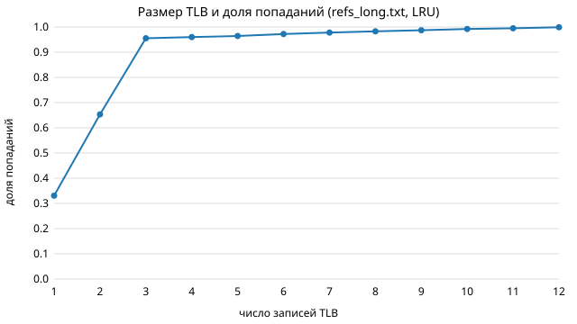

# ПР-10. Страничная организация

**Автор:** Эркинбеков Айман · **Дисциплина:** Операционные системы · **Вариант:** B

## Тема и цель

Реализовать трансляцию логического адреса в физический по таблице страниц,
смоделировать TLB и оценить, как он влияет на время доступа к памяти. Отдельно
посмотреть, сколько обращений к памяти стоит одна трансляция в двухуровневой
таблице страниц и зачем такая таблица вообще нужна.

Связь с лекцией 10: страницы и кадры, таблица страниц, трансляция адреса, TLB,
эффективное время доступа.

## Исходные данные

- Размер страницы **1 КБ (1024 Б)**, логическое пространство **16 КБ (16 страниц)**.
- `pagetable.txt`: таблица страниц, строки `страница кадр`, `-` значит «страница
  отсутствует в памяти». Первые четыре строки взяты из условия: `0→5, 1→2, 2→7, 3→0`.
  Страницы 4, 7, 10 и 13 отсутствуют.
- `refs.txt`: 30 логических адресов. Первые три (1200, 3100, 5000) контрольные для
  ручного расчёта; дальше обращения с локальностью, два адреса на отсутствующие
  страницы и один адрес за пределами пространства (17000).
- `refs_long.txt`: 10 000 обращений с локальностью для графика, генерирует
  `gen_refs.py` с `seed = 42`.

## Что сделано и как это работает

- **Трансляция** (`translate.py`): `page = addr // 1024`, `offset = addr % 1024`,
  кадр ищется в таблице, физический адрес `frame * 1024 + offset`. Отсутствующая
  страница даёт `PageFault` («страничный отказ»), адрес вне 0..16383 даёт
  `BadAddress`. Программа не падает ни на том, ни на другом, а пишет сообщение.
- **TLB** (`tlb.py`): класс `TLB` на K записей поверх `OrderedDict`. При попадании
  запись переносится в конец (самая свежая), при переполнении вытесняется первая
  (самая давняя). Это и есть LRU. Для каждого обращения пишется `hit` или `miss`
  и текущее содержимое TLB. При страничном отказе трансляции нет, поэтому в TLB
  ничего не кладётся.
- **EAT** (`tlb.py`): эффективное время доступа при памяти 100 нс и TLB 10 нс.
- **График** (`gen_refs.py`, `tlb_plot.py`): длинная строка с локальностью
  (программа работает в окне из 3 соседних страниц и с вероятностью 2% перескакивает
  в другое место), прогон для K = 1..12, график `tlb_hit.svg` без сторонних библиотек.
- **Двухуровневая таблица** (`twolevel.py`): номер страницы делится на `p1`
  (индекс во внешней таблице) и `p2` (индекс во внутренней). Каждое чтение таблицы
  считается обращением к памяти. Плюс расчёт объёма таблиц для 32-битного адреса.
- **`check_pr10.py`**: 18 проверок, в том числе сверка TLB с независимым эталоном
  LRU на 10 000 обращений и сверка трансляции через `//` и `%` со сдвигом и маской
  на 5000 случайных адресах.

## Файлы

| Файл | За что отвечает |
| --- | --- |
| `README.md` | Отчёт |
| `run.sh` | Вся работа одной командой |
| `translate.py` | Трансляция адреса; `./translate.py 1200 3100 5000` переводит отдельные адреса |
| `tlb.py` | TLB с LRU, hit/miss по шагам (`-v`), размер TLB (`-k`), таблица EAT |
| `gen_refs.py` | Генератор `refs_long.txt` (seed 42) |
| `tlb_plot.py` | Прогон K = 1..12 и график `tlb_hit.svg` |
| `twolevel.py` | Двухуровневая таблица и объём таблиц для 32 бит |
| `check_pr10.py` | Автоматическая проверка (18 проверок) |
| `pagetable.txt`, `refs.txt`, `refs_long.txt` | Данные |
| `tlb_hit.svg` | График «размер TLB → доля попаданий» |
| `evidence/translate.txt`, `evidence/manual_check.txt` | Вывод трансляции |
| `evidence/tlb_refs.txt`, `evidence/tlb_sizes.txt` | TLB на `refs.txt` по шагам и при разных K |
| `evidence/gen_refs.txt`, `evidence/tlb_plot.txt` | Длинная строка и таблица для графика |
| `evidence/twolevel.txt` | Двухуровневая таблица |
| `evidence/check.txt` | Вывод `check_pr10.py` |
| `evidence/environment.txt` | Python, архитектура, ядра, система |

## Среда

Ubuntu 26.04 в Docker-контейнере (`ubuntu:26.04`, arm64) на macOS, Python 3.14.4,
только стандартная библиотека. Весь вывод в `evidence/` снят в этом контейнере.

## Как запустить

Нужен только `python3`.

```bash
./run.sh
```

По частям:

```bash
./translate.py
./translate.py 1200 3100 5000
./tlb.py -v
./tlb.py -k 8
./gen_refs.py && ./tlb_plot.py
./twolevel.py
./check_pr10.py
```

## 1. Ручной расчёт трёх адресов

Таблица `0→5, 1→2, 2→7, 3→0`, страница 1024 Б.

| Адрес | Страница = адрес // 1024 | Смещение = адрес % 1024 | Кадр | Физический адрес |
| ---: | --- | --- | --- | --- |
| 1200 | 1200 // 1024 = **1** | 1200 − 1024 = **176** | 2 | 2 · 1024 + 176 = **2224** |
| 3100 | 3100 // 1024 = **3** | 3100 − 3072 = **28** | 0 | 0 · 1024 + 28 = **28** |
| 5000 | 5000 // 1024 = **4** | 5000 − 4096 = **904** | нет | **страничный отказ**: страницы 4 в таблице нет |

Программа даёт то же самое (`evidence/manual_check.txt`):

```text
Размер страницы 1024 Б, страниц 16, обращений 3
  1200  стр  1 смещ  176  ->  кадр  2  физ 2 * 1024 + 176 = 2224
  3100  стр  3 смещ   28  ->  кадр  0  физ 0 * 1024 + 28 = 28
  5000  стр  4 смещ  904  ->  страница 4 отсутствует (страничный отказ)
Итого: переведено 2, страничных отказов 1, неверных адресов 0
```

Весь `refs.txt` (`evidence/translate.txt`): переведено 27 адресов, 2 страничных
отказа (5000 и 7300: страницы 4 и 7) и 1 неверный адрес (17000 больше 16383).

**Почему размер страницы выбирают степенью двойки.** При 1024 = 2^10 номер
страницы и смещение не нужно вычислять делением: младшие 10 бит адреса и есть
смещение, а старшие биты есть номер страницы. В железе это просто разводка
проводов, `page = addr >> 10`, `offset = addr & 1023`, а физический адрес
получается приклеиванием номера кадра к смещению: `(frame << 10) | offset`. Если бы
страница была 1000 Б, MMU пришлось бы на каждом обращении делить, а это медленно.
`check_pr10.py` сверяет оба способа на 5000 случайных адресах.

## 2. TLB на 4 записи

Фрагмент `evidence/tlb_refs.txt` (в конце строки содержимое TLB от давней записи к свежей):

```text
  1200  стр  1  miss  физ  2224  TLB [1]
  3100  стр  3  miss  физ    28  TLB [1, 3]
  5000  стр  4  miss  страничный отказ
  1300  стр  1  hit   физ  2324  TLB [3, 1]
  1250  стр  1  hit   физ  2274  TLB [3, 1]
  2100  стр  2  miss  физ  7220  TLB [3, 1, 2]
  2200  стр  2  hit   физ  7320  TLB [3, 1, 2]
  3200  стр  3  hit   физ   128  TLB [1, 2, 3]
   100  стр  0  miss  физ  5220  TLB [1, 2, 3, 0]
  1024  стр  1  hit   физ  2048  TLB [2, 3, 0, 1]
  ...
  6200  стр  6  miss  физ  1080  TLB [3, 0, 1, 6]
...
TLB: K = 4, LRU; обращений 30: hit 14, miss 15, из них отказов 2; неверных адресов 1
Доля попаданий h = 14/29 = 0.483
```

Видно, как работает LRU: на `6200` TLB полон `[2, 3, 0, 1]`, страница 2 дольше всех
не использовалась, она и вытесняется. Адрес 17000 не считается ни попаданием, ни
промахом: до TLB дело не доходит, MMU отказывает раньше.

Доля попаданий на `refs.txt` при разных K (`evidence/tlb_sizes.txt`):

| K | 1 | 2 | 3 | 4 | 6 | 8 |
| --- | --- | --- | --- | --- | --- | --- |
| hit из 29 | 10 | 11 | 12 | 14 | 17 | 18 |
| h | 0,345 | 0,379 | 0,414 | 0,483 | 0,586 | 0,621 |

Строка короткая (30 адресов, 11 разных страниц, из них 9 загружены), поэтому много холодных промахов:
первое обращение к любой странице всегда промах. Даже бесконечный TLB дал бы здесь
только 18 попаданий из 29.

## 3. Эффективное время доступа

При попадании: TLB + данные = 10 + 100 = 110 нс. При промахе: TLB + таблица страниц
+ данные = 10 + 100 + 100 = 210 нс.

`EAT = h · 110 + (1 − h) · 210`

| h | EAT, нс | Во сколько раз медленнее одного обращения к памяти |
| ---: | ---: | ---: |
| 0,00 | 210,0 | 2,10 |
| 0,50 | 160,0 | 1,60 |
| 0,80 | 130,0 | 1,30 |
| 0,90 | 120,0 | 1,20 |
| 0,95 | 115,0 | 1,15 |
| 0,98 | 112,0 | 1,12 |
| 0,99 | 111,0 | 1,11 |
| 1,00 | 110,0 | 1,10 |
| **0,483 (refs.txt, K = 4)** | **161,7** | **1,62** |

Без TLB любое обращение стоит 200 нс. На `refs.txt` TLB выигрывает немного
(161,7 против 200), потому что строка короткая и почти половина обращений
приходится на холодные промахи. На длинной строке с локальностью картина другая
(раздел 4): уже при K = 3 доля попаданий 0,955 и EAT 114,5 нс, это всего на 14,5%
медленнее идеальной памяти без трансляции.

## 4. Размер TLB и доля попаданий

`refs_long.txt`: 10 000 обращений, 12 загруженных страниц, окно 3 страницы
(`evidence/tlb_plot.txt`):

```text
  K     hit   miss       h   EAT, нс
  1    3307   6693   0.331     176.9
  2    6532   3468   0.653     144.7
  3    9553    447   0.955     114.5
  4    9599    401   0.960     114.0
  5    9644    356   0.964     113.6
  6    9721    279   0.972     112.8
  7    9777    223   0.978     112.2
  8    9830    170   0.983     111.7
  9    9873    127   0.987     111.3
 10    9920     80   0.992     110.8
 11    9951     49   0.995     110.5
 12    9988     12   0.999     110.1
```



- Самый большой скачок между K = 2 и K = 3: окно программы как раз 3 страницы.
  Пока TLB меньше рабочего множества, он постоянно выталкивает страницу, которая
  понадобится через одно-два обращения. Как только рабочее множество помещается,
  промахи остаются только на перескоках.
- Дальше кривая почти плоская: каждая новая запись помогает только при перескоках,
  а их 2%. Поэтому реальные TLB маленькие (десятки и сотни записей), но дают
  попадания выше 99%: программы почти всегда работают с небольшим набором страниц.
- При K = 12 TLB вмещает все 12 страниц, остаются ровно 12 холодных промахов.
- Кривая не убывает ни в одной точке: LRU стековый алгоритм, больший TLB всегда
  содержит всё, что содержал бы меньший (проверяется в `check_pr10.py`).

## 5. Двухуровневая таблица страниц

Для нашего пространства номер страницы 4 бита, делю его на `p1` (2 бита) и `p2`
(2 бита): внешняя таблица на 4 записи, каждая указывает на внутреннюю на 4 записи
(`evidence/twolevel.txt`):

```text
 адрес  p1 p2 смещ     физ  обращений к памяти
  1200   0  1  176    2224  3
  3100   0  3   28      28  3
  5000  отказ: страница 4 отсутствует
  1300   0  1  276    2324  3
```

Сколько обращений к памяти стоит одно обращение программы без TLB:

| Таблица | Чтения таблиц | + данные | Всего | Время |
| --- | ---: | ---: | ---: | ---: |
| Одноуровневая | 1 | 1 | 2 | 200 нс |
| Двухуровневая | 2 | 1 | **3** | 300 нс |
| Любая, попадание в TLB | 0 | 1 | 1 | 110 нс |

То есть каждый уровень добавляет ещё одно обращение к памяти при промахе TLB, а у
4-уровневой таблицы x86-64 промах стоит уже 5 обращений. Для двухуровневой таблицы
`EAT = h · 110 + (1 − h) · 310`, и TLB здесь ещё важнее.

**Зачем тогда два уровня.** Ради памяти. Для 32-битного адреса со страницей 4 КБ
одноуровневая таблица содержит 2^20 записей по 4 Б, это **4 МБ на каждый процесс**,
даже если процесс почти ничего не использует. В двухуровневой (10 + 10 + 12 бит)
внутренние таблицы создаются только для занятых областей. Процесс с кодом 1 МБ,
кучей 8 МБ и стеком 1 МБ:

```text
  одноуровневая: 2^20 записей * 4 Б = 4096 КБ на каждый процесс
  двухуровневая: внешняя 4 КБ + 4 внутренних по 4 КБ = 20 КБ (в 205 раз меньше)
```

## Проверка

`evidence/check.txt`:

```text
[ok]     1200 -> стр 1, смещ 176 -> физ 2224
[ok]     3100 -> стр 3, смещ 28 -> физ 28
[ok]     5000 -> стр 4: страничный отказ
[ok]     первые три адреса refs.txt - контрольные 1200, 3100, 5000
[ok]     адрес 16384 и -1 - неверные
[ok]     границы страницы: 1023 -> (0, 1023), 1024 -> (1, 0)
[ok]     5000 случайных адресов: деление/остаток совпадает со сдвигом/маской
[ok]     LRU: после обращения к 1 вытесняется 2, а не 1
[ok]     TLB на refs_long.txt совпадает с эталонным LRU-стеком при K = 1, 2, 3, 4, 8, 12
[ok]     доля попаданий не убывает с ростом TLB (LRU - стековый алгоритм)
[ok]     refs.txt, K = 4: 14 hit, 15 miss, 2 отказа, 1 неверный адрес
[ok]     refs_long.txt воспроизводится тем же seed
[ok]     EAT(1) = 110, EAT(0) = 210, EAT(0.9) = 120
[ok]     EAT для двухуровневой таблицы при промахе = 310
[ok]     двухуровневая даёт те же адреса, что и одноуровневая, за 3 обращения к памяти
[ok]     32 бита / 4 КБ: плоская таблица 4 МБ, двухуровневая 20 КБ
[ok]     translate.py 1200 3100 5000: код 0, 2224 и 28 в выводе, отказ для 5000
[ok]     tlb.py -k 0: понятная ошибка, а не зависание

Проверок: 18, провалено: 0
```

## Контрольные вопросы

**Почему без TLB страничная организация замедлила бы каждое обращение к памяти
вдвое и более?** Таблица страниц сама лежит в оперативной памяти. Чтобы прочитать
один байт данных, MMU сначала должен прочитать запись таблицы, то есть сходить в
память ещё раз: 2 обращения вместо одного. В многоуровневой таблице на каждый
уровень добавляется ещё одно обращение (3 для двух уровней, 5 для четырёх уровней
x86-64). TLB хранит последние трансляции прямо в процессоре, и при попадании
таблица не читается вообще.

**Что хранится в записи таблицы страниц помимо номера кадра?**
- бит присутствия (present/valid): загружена ли страница; если нет, будет страничный отказ;
- права: чтение, запись, выполнение (NX), доступ из режима пользователя или только из ядра;
- бит обращения (accessed/referenced): к странице обращались, нужен алгоритмам замещения (Clock в ПР-11);
- бит изменения (dirty): в страницу писали, перед вытеснением её надо сохранить на диск;
- биты кэширования (запрет кэша для памяти устройств) и бит global (не сбрасывать из TLB при переключении процесса).

## Типичные ошибки, которых я избегал

- Смещение считается по 1024, а не по 1000: размер страницы задан одной константой `PAGE_SIZE`.
- Физический адрес собирается как `кадр * 1024 + смещение`, а не `кадр + смещение`.
- Обращение к отсутствующей странице не роняет программу: выводится «страничный отказ», работа продолжается.
- Адрес за пределами пространства обрабатывается отдельно от страничного отказа: это разные ситуации (ошибка программы и нормальная подкачка).
- При отказе TLB не заполняется: трансляции, которую можно было бы туда положить, нет.

## Выводы

- Трансляция адреса сводится к делению адреса на номер страницы и смещение; при
  размере страницы 2^k это просто старшие и младшие биты.
- Ручной расчёт и программа совпали: 1200 → 2224, 3100 → 28, 5000 → страничный отказ.
- TLB полезен настолько, насколько программа обладает локальностью. На строке с
  окном в 3 страницы TLB из 3 записей даёт 95,5% попаданий и EAT 114,5 нс против
  200 нс без TLB; дальнейший рост TLB почти ничего не добавляет.
- Многоуровневая таблица экономит память (20 КБ вместо 4 МБ в примере), но каждый
  уровень добавляет обращение к памяти при промахе TLB, поэтому без TLB она была бы
  неприемлемо медленной.
