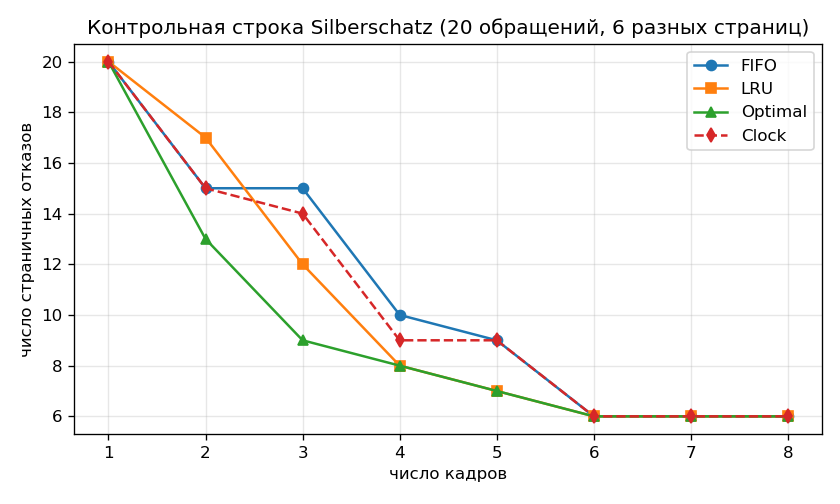

# ПР-11. Алгоритмы замещения страниц

**Автор:** Эркинбеков Айман · **Дисциплина:** Операционные системы · **Вариант:** B

## Тема и цель

Реализовать и сравнить алгоритмы замещения страниц FIFO, LRU, Optimal и Clock;
воспроизвести и объяснить аномалию Белади.

Связь с лекцией 11 «Виртуальная память»: подкачка по требованию, страничный
отказ, алгоритмы замещения, аномалия Белади, пробуксовка.

## Исходные данные

- Контрольная строка обращений (Silberschatz):
  `7 0 1 2 0 3 0 4 2 3 0 3 2 1 2 0 1 7 0 1`.
  Эталон при 3 кадрах (УМК): FIFO 15, LRU 12, Optimal 9, Clock 14.
- Строка для аномалии Белади: `1 2 3 4 1 2 5 1 2 3 4 5`.
- Две строки по 1000 обращений к 20 страницам (`random.txt`, `locality.txt`),
  генерирует `compare.py` с `seed = 2026`.

## Что сделано и как это работает

Все четыре алгоритма в `replace.py`, у каждого одинаковый интерфейс
`алгоритм(строка, число_кадров, trace=False)`, результат: число отказов, а при
`trace=True` ещё состояние кадров после каждого шага.

- **FIFO**: очередь в порядке загрузки. При отказе вытесняется голова очереди.
  Попадание очередь не меняет, поэтому страница, нужная постоянно, всё равно
  уходит, когда подойдёт её очередь.
- **LRU**: для каждой страницы хранится время последнего обращения. Оно
  обновляется **при каждом обращении**, а не только при отказе. При отказе
  вытесняется страница с самым старым временем.
- **Optimal**: при отказе для каждой страницы в кадрах ищется её следующее
  обращение **вперёд** по строке. Вытесняется та, что понадобится позже всех;
  страница, которая больше не встретится, нужна «никогда» и уходит первой.
- **Clock (второй шанс)**: кадры стоят по кругу, у каждого бит обращения. При
  попадании бит = 1. При отказе стрелка идёт по кругу: бит 1 сбрасывается в 0
  (странице даётся второй шанс), на первом кадре с битом 0 стрелка
  останавливается, туда кладётся новая страница с битом 1, и **стрелка
  сдвигается дальше**.
- В LRU и Clock считается работа: сколько элементарных действий алгоритм делает
  на одно обращение (`work`).
- **`check_pr11.py`**: 22 проверки. Кроме эталонов, каждый алгоритм сверяется с
  независимой реализацией: LRU со стеком, Clock с «вторым шансом» через очередь,
  Optimal с минимумом, найденным полным перебором всех возможных решений о вытеснении.

## Файлы

| Файл | За что отвечает |
| --- | --- |
| `README.md` | Отчёт |
| `run.sh` | Вся работа одной командой |
| `replace.py` | FIFO, LRU, Optimal, Clock; таблица отказов; `-f` кадры, `-s` строка, `-v` по шагам |
| `plot_faults.py` | Кадры 1..8 на контрольной строке и график `faults.png` |
| `belady.py` | Аномалия Белади: все алгоритмы при 1..7 кадрах, проверка свойства включения |
| `compare.py` | Строки `random.txt` и `locality.txt`, сравнение при 5 кадрах, работа на обращение |
| `check_pr11.py` | Автоматическая проверка (22 проверки) |
| `requirements.txt` | `matplotlib` для графика (уровень B) |
| `faults.png` | График «число кадров → число отказов» |
| `random.txt`, `locality.txt` | Строки по 1000 обращений |
| `evidence/table.txt`, `evidence/trace3.txt` | Таблица для 3 и 4 кадров, пошаговое состояние кадров |
| `evidence/frames_1_8.txt` | Таблица для графика |
| `evidence/belady.txt` | Аномалия Белади |
| `evidence/compare.txt` | Сравнение на строках по 1000 обращений |
| `evidence/check.txt` | Вывод `check_pr11.py` |
| `evidence/environment.txt` | Python, matplotlib, архитектура, ядра, система |

## Среда

Ubuntu 26.04 в Docker-контейнере (`ubuntu:26.04`, arm64) на macOS, Python 3.14.4,
matplotlib 3.10.7. Весь вывод в `evidence/` снят в этом контейнере.

## Как запустить

Нужен Python 3.8 или новее. `replace.py` работает на стандартной библиотеке,
matplotlib нужен только для графика:

```bash
sudo apt install python3-venv
python3 -m venv .venv && . .venv/bin/activate
pip install -r requirements.txt
./run.sh
```

По частям:

```bash
python3 replace.py
python3 replace.py -f 3 -v
python3 replace.py -f 3 4 -s "1 2 3 4 1 2 5 1 2 3 4 5"
python3 plot_faults.py
python3 belady.py
python3 compare.py
python3 check_pr11.py
```

## 1. Таблица на контрольной строке

`evidence/table.txt`:

```text
Строка: 7 0 1 2 0 3 0 4 2 3 0 3 2 1 2 0 1 7 0 1
Кадры     FIFO      LRU  Optimal    Clock
    3       15       12        9       14
    4       10        8        8        9
```

| Кадры | FIFO | LRU | Optimal | Clock (уровень B) |
| :-: | :-: | :-: | :-: | :-: |
| 3 | 15 | 12 | 9 | 14 |
| 4 | 10 | 8 | 8 | 9 |

При 3 кадрах все числа совпали с эталоном УМК: FIFO 15, LRU 12, Optimal 9, Clock 14.

Как Clock получает 14 при 3 кадрах (`evidence/trace3.txt`, `F` = отказ):

```text
   7  F  [7]
   0  F  [7, 0]
   1  F  [7, 0, 1]
   2  F  [2, 0, 1]  вытеснена 7
   0     [2, 0, 1]
   3  F  [2, 0, 3]  вытеснена 1
   0     [2, 0, 3]
   4  F  [4, 0, 3]  вытеснена 2
   2  F  [4, 2, 3]  вытеснена 0
   ...
  отказов: 14
```

Разберу два первых вытеснения:

- На `2` все три кадра заняты и у всех бит 1 (только что загружены). Стрелка
  проходит полный круг, сбрасывает биты у 7, 0 и 1, возвращается к кадру 0 и
  вытесняет 7. Новая страница 2 получает бит 1, стрелка встаёт на кадр 1.
- На `0` попадание, бит страницы 0 снова 1.
- На `3` стрелка стоит на кадре 1 (страница 0, бит 1): сбрасывает бит, даёт
  странице 0 второй шанс и переходит к кадру 2 (страница 1, бит 0 с прошлого
  круга). Вытесняется 1.

Так Clock сохранил страницу 0, к которой только что обращались. FIFO на том же
месте вытеснил бы 0 как самую старую по загрузке, поэтому Clock лучше FIFO
(14 против 15).

**Какой алгоритм даёт нижнюю границу и почему его нельзя применить в ОС.**
Нижнюю границу даёт **Optimal** (алгоритм Белади, MIN): при любом числе кадров
у него меньше всего отказов. Это не только видно в таблице, но и проверено:
на 150 коротких строках Optimal совпадает с минимумом, найденным полным перебором
всех вариантов вытеснения. Применить его в реальной ОС нельзя: ему нужно знать
**будущие** обращения, а ОС знает только прошлые. Optimal используют как эталон,
с которым сравнивают реальные алгоритмы: LRU (12) ближе всех к нему (9).

## 2. Clock против LRU

По числу отказов Clock между FIFO и LRU: 14 против 15 и 12 при 3 кадрах, 9 против
10 и 8 при 4. Он приближает LRU: бит обращения показывает «использовалась ли
страница недавно», но не *насколько* недавно.

По объёму работы Clock заметно дешевле (`evidence/compare.txt`, 5 кадров):

```text
Работа на одно обращение (элементарные действия), 5 кадров:
   строка     LRU   Clock
   random    4.74    1.85
 locality    1.83    1.22
```

- **LRU** должен записывать время **при каждом обращении** (1 действие), а при
  отказе просмотреть время всех кадров (ещё 5). В железе это означает счётчик
  или перестановку стека на каждый доступ к памяти, поэтому настоящий LRU в ОС
  почти не реализуют.
- **Clock** при попадании только ставит бит 1, а MMU делает это сам, бесплатно
  для ОС. Работа есть только при отказе: стрелка проходит в среднем 1–2 кадра.
  Поэтому Linux, BSD и Windows используют варианты Clock (у Linux активный и
  неактивный списки, а с версии 6.1 Multi-Gen LRU).

## 3. Кадры 1..8 и график

`evidence/frames_1_8.txt`:

```text
Кадры     FIFO      LRU  Optimal    Clock
    1       20       20       20       20
    2       15       17       13       15
    3       15       12        9       14
    4       10        8        8        9
    5        9        7        7        9
    6        6        6        6        6
    7        6        6        6        6
    8        6        6        6        6
разных страниц в строке: 6
```



**Почему при 6 и более кадрах все линии сходятся.** В строке всего 6 разных страниц
(0, 1, 2, 3, 4, 7). При 6 кадрах помещаются все, вытеснять ничего не нужно,
поэтому отказы остаются только **обязательные** (холодные): первое обращение к
каждой странице. Их 6 при любом алгоритме, и добавление кадров больше ничего не
меняет. При 1 кадре наоборот: страница в строке никогда не повторяется два раза
подряд, поэтому отказ на каждом обращении, 20 у всех.

Видно и то, что LRU не всегда лучше FIFO: при 2 кадрах LRU 17, а FIFO 15. LRU
хорош при локальности, а на строке, где страницы ходят по кругу, он раз за разом
выталкивает ту, что понадобится следующей.

## 4. Аномалия Белади

`evidence/belady.txt`:

```text
Строка: 1 2 3 4 1 2 5 1 2 3 4 5
Кадры     FIFO      LRU  Optimal    Clock
    1       12       12       12       12
    2       12       12        9       12
    3        9       10        7        9
    4       10        8        6       10
    5        5        5        5        5
    6        5        5        5        5
    7        5        5        5        5

   FIFO: АНОМАЛИЯ (3 кадра: 9 -> 4 кадра: 10)
    LRU: аномалии нет, отказы не растут с числом кадров
Optimal: аномалии нет, отказы не растут с числом кадров
  Clock: АНОМАЛИЯ (3 кадра: 9 -> 4 кадра: 10)

   FIFO: свойство включения M(n) ⊆ M(n+1) НАРУШЕНО
    LRU: свойство включения M(n) ⊆ M(n+1) выполняется
Optimal: свойство включения M(n) ⊆ M(n+1) выполняется
  Clock: свойство включения M(n) ⊆ M(n+1) НАРУШЕНО
```

У FIFO при 4 кадрах отказов **больше** (10), чем при 3 (9). Пошагово:

```text
FIFO, 3 кадра                          FIFO, 4 кадра
   5  F  [5, 1, 2]  вытеснена 4           5  F  [5, 2, 3, 4]  вытеснена 1
   1     [5, 1, 2]                        1  F  [5, 1, 3, 4]  вытеснена 2
   2     [5, 1, 2]                        2  F  [5, 1, 2, 4]  вытеснена 3
   3  F  [5, 3, 2]  вытеснена 1           3  F  [5, 1, 2, 3]  вытеснена 4
   4  F  [5, 3, 4]  вытеснена 2           4  F  [4, 1, 2, 3]  вытеснена 5
   5     [5, 3, 4]                        5  F  [4, 5, 2, 3]  вытеснена 1
```

С 3 кадрами к моменту прихода `5` в памяти оказались как раз `1` и `2`, которые
нужны дальше. С 4 кадрами в очереди другой порядок: при `5` уходит `1`, затем
каждая следующая страница выталкивает ту, что нужна сразу после неё, и отказы идут
подряд шесть раз.

**Объяснение через стековый алгоритм.** Алгоритм называется стековым, если для
любой строки и в любой момент набор страниц в памяти из n кадров входит в набор
из n + 1 кадров: `M(n) ⊆ M(n+1)`. Тогда всё, что было попаданием при n кадрах,
останется попаданием при n + 1, и отказов не может стать больше.
- **LRU стековый**: при n кадрах в памяти n последних использованных страниц, при
  n + 1 те же n и ещё одна.
- **Optimal стековый**: в памяти страницы, которые понадобятся раньше всего, и при
  n + 1 кадрах это те же n плюс следующая.
- **FIFO не стековый**: содержимое зависит от *времени загрузки*, а оно разное при
  разном числе кадров. `belady.py` показывает, что на этой строке включение у FIFO
  нарушается. **Clock** по сути FIFO с битом второго шанса, поэтому тоже не стековый
  и на этой строке даёт ту же аномалию 9 → 10.

## 5. Случайная строка и строка с локальностью

1000 обращений к 20 страницам, 5 кадров, `seed = 2026`. В `random.txt` каждое
обращение к случайной странице; в `locality.txt` программа работает в окне из 4
соседних страниц и с вероятностью 5% перескакивает (`evidence/compare.txt`):

```text
   строка     FIFO      LRU  Optimal    Clock   доля отказов LRU
   random      755      753      484      760   75.3%
 locality      177      171      127      170   17.1%
```

- **Случайная строка**: алгоритмы, которые смотрят в прошлое (FIFO, LRU, Clock),
  практически одинаковы, около 75% отказов. Это почти ровно 1 − 5/20 = 75%: при
  случайных обращениях прошлое ничего не говорит о будущем, и любой выбор жертвы
  не лучше случайного. Помочь может только знание будущего, поэтому Optimal
  отрывается (484).
- **Строка с локальностью**: отказов в 4 с лишним раза меньше у всех. Окно 4
  страницы помещается в 5 кадров, отказы остаются в основном на перескоках.
  Здесь прошлое предсказывает будущее, и LRU (171) и Clock (170) заметно ближе к
  Optimal (127), чем на случайной строке.

Вывод: алгоритмы замещения работают за счёт локальности программ, а реальные
программы как раз ведут себя как вторая строка.

## Проверка

`evidence/check.txt`:

```text
[ok]     контрольная строка, 3 кадра: FIFO 15
[ok]     контрольная строка, 3 кадра: LRU 12
[ok]     контрольная строка, 3 кадра: Optimal 9
[ok]     контрольная строка, 3 кадра: Clock 14
[ok]     4 кадра: FIFO 10, LRU 8, Optimal 8, Clock 9
[ok]     при 6 и более кадрах у всех 6 отказов (6 разных страниц)
[ok]     Белади: FIFO 3 кадра 9 отказов, 4 кадра 10
[ok]     LRU и Optimal на строке Белади не растут с числом кадров
[ok]     LRU совпадает с эталонным стеком на 300 случайных строках
[ok]     Clock совпадает с «вторым шансом» через очередь на 300 строках
[ok]     Optimal равен минимуму полного перебора на 150 коротких строках
[ok]     Optimal никогда не хуже FIFO, LRU и Clock
[ok]     при 1 кадре все алгоритмы дают одинаково
[ok]     LRU обновляет время при попадании: 1 2 1 3 при 2 кадрах вытесняет 2
[ok]     Optimal смотрит вперёд: 1 2 3 1 при 2 кадрах вытесняет 2
[ok]     повторное обращение к загруженной странице не отказ
[ok]     Clock: стрелка сдвигается после замены (1 2 3 4 при 2 кадрах: 4 отказа, 4 на месте 2)
[ok]     строки random и locality воспроизводятся (seed)
[ok]     на строке с локальностью отказов меньше у всех алгоритмов
[ok]     Clock делает меньше работы на обращение, чем LRU
[ok]     python3 replace.py: код 0 и строка «3 15 12 9 14»
[ok]     replace.py -f 0: понятная ошибка

Проверок: 22, провалено: 0
```

## Контрольные вопросы

**Почему LRU не подвержен аномалии Белади, а FIFO подвержен?** LRU стековый
алгоритм: при n кадрах в памяти всегда n последних использованных страниц, а при
n + 1 кадрах те же самые плюс ещё одна. Значит, всё, что было попаданием при
меньшей памяти, будет попаданием и при большей, и отказов не может стать больше.
FIFO решает по времени загрузки, а оно при разном числе кадров разное, поэтому
наборы страниц в памяти не вложены друг в друга, и с лишним кадром в памяти может
оказаться «не та» страница (строка Белади: 9 отказов при 3 кадрах, 10 при 4).

**Чем major page fault отличается от minor?**
- **Minor** (мягкий): страница уже есть в оперативной памяти, но не отображена в
  таблицу страниц процесса. Например, она в страничном кэше, её только что
  выделили (первое обращение к памяти от `malloc` получает обнулённый кадр) или её
  уже загрузил другой процесс (общая библиотека). Ядру достаточно поправить
  таблицу страниц, диск не нужен: микросекунды.
- **Major** (жёсткий): страницы в памяти нет, ядро читает её с диска (из файла или
  из свопа), а процесс в это время спит. Это миллисекунды на HDD, в тысячи раз
  дольше. Большое число major-отказов означает нехватку памяти, а в пределе
  пробуксовку (thrashing), когда система почти всё время занята подкачкой.

## Типичные ошибки, которых я избегал

- В LRU время последнего обращения обновляется при каждом обращении, а не только
  при отказе (иначе получился бы FIFO). Проверка: `1 2 1 3` при 2 кадрах вытесняет `2`.
- Optimal смотрит в будущее, а не в прошлое. Проверка: `1 2 3 1` при 2 кадрах вытесняет `2`.
- Повторное обращение к уже загруженной странице не засчитывается как отказ.
- В Clock стрелка сдвигается после замены, иначе следующий отказ сразу выбросит
  только что загруженную страницу.

## Выводы

- Все четыре алгоритма совпали с эталоном УМК: при 3 кадрах FIFO 15, LRU 12,
  Optimal 9, Clock 14.
- Optimal даёт нижнюю границу, но требует знания будущего, поэтому служит только
  эталоном. LRU к нему ближе всех, но дорог; Clock почти так же хорош, а работы на
  обращение у него в 1,5–2,5 раза меньше, поэтому ОС используют его варианты.
- Аномалия Белади воспроизведена: FIFO (и Clock) при 4 кадрах даёт 10 отказов
  против 9 при 3. Стековые алгоритмы (LRU, Optimal) ей не подвержены.
- Замещение страниц работает только благодаря локальности: на случайной строке
  все реалистичные алгоритмы одинаково плохи (75% отказов), на строке с
  локальностью отказов в 4 раза меньше.
