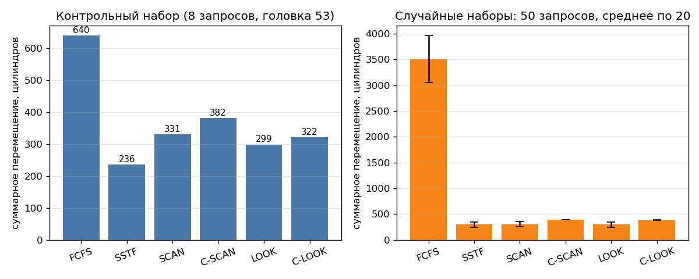

# ПР-13. Планирование диска

**Автор:** Эркинбеков Айман · **Дисциплина:** Операционные системы · **Вариант:** B

## Тема и цель

Реализовать алгоритмы планирования обращений к диску и сравнить их по
перемещению головки. На уровне B: все шесть алгоритмов с единым интерфейсом,
сверка с эталоном, сравнение на случайных наборах с усреднением, демонстрация
голодания в SSTF и оценка справедливости SSTF и C-LOOK.

Связь с лекцией 13: устройство HDD/SSD, время доступа, FCFS, SSTF, SCAN,
C-SCAN, LOOK, C-LOOK.

## Исходные данные

Контрольный набор (Silberschatz): 200 цилиндров (0–199), головка на 53, движение
к бо́льшим номерам, очередь `98, 183, 37, 122, 14, 124, 65, 67`.

Эталон суммарного перемещения: FCFS 640, SSTF 236, SCAN 331, C-SCAN 382,
LOOK 299, C-LOOK 322.

## Что сделано и как это работает

Все алгоритмы в `disk.py`, интерфейс одинаковый:
`алгоритм(очередь, головка, направление, цилиндров)` → объект с порядком
обслуживания `order`, полным путём головки `path` (с краями диска и прыжками) и
суммарным перемещением `movement` = сумма |разностей| соседних точек пути.

- **FCFS**: в порядке прихода.
- **SSTF**: каждый раз ближайший к головке запрос (при равенстве в сторону движения).
- **SCAN** (лифт): обслуживает всё по ходу, **доезжает до края** (199) и
  разворачивается.
- **LOOK**: как SCAN, но разворачивается на последнем запросе и до края не едет.
- **C-SCAN**: обслуживает по ходу до края, затем **возвращается в цилиндр 0** и
  снова идёт вверх. Возврат 199 → 0 засчитывается в перемещение: так считает эталон
  (382 = 146 + 199 + 37).
- **C-LOOK**: после последнего запроса прыжок к самому младшему запросу, прыжок
  тоже засчитывается (322 = 130 + 169 + 23).

Остальное:
- `compare.py`: контрольный набор и 20 случайных наборов по 50 запросов
  (случайная головка, `seed = 13`), среднее, разброс, график `movement.png`.
- `dynamic.py`: запросы приходят во время работы. Головка проходит 1 цилиндр
  за единицу времени, после каждого обслуживания выбирается следующий запрос из
  уже пришедших. Сценарий голодания и случайный поток для оценки справедливости.
- `check_pr13.py`: 19 проверок, в том числе на 1000 случайных очередях (каждый
  запрос обслужен ровно один раз, SSTF всегда берёт ближайший, LOOK не хуже SCAN)
  и сверка с оптимумом полного перебора всех порядков обслуживания.

## Файлы

| Файл | За что отвечает |
| --- | --- |
| `README.md` | Отчёт |
| `run.sh` | Вся работа одной командой |
| `disk.py` | Шесть алгоритмов; `-v` путь головки, `-q` своя очередь, `-H` головка, `-d up/down` |
| `compare.py` | Контрольный и 20 случайных наборов, график `movement.png` |
| `dynamic.py` | Голодание SSTF, справедливость SSTF и C-LOOK |
| `check_pr13.py` | Автоматическая проверка (19 проверок) |
| `requirements.txt` | `matplotlib` для графика |
| `movement.png` | График «алгоритм → суммарное перемещение» |
| `evidence/control.txt` | Контрольный набор с путём головки |
| `evidence/compare.txt`, `evidence/dynamic.txt` | Сравнение, голодание, справедливость |
| `evidence/check.txt` | Вывод `check_pr13.py` |
| `evidence/environment.txt` | Python, matplotlib, архитектура, система |

## Среда

Ubuntu 26.04 в Docker-контейнере (`ubuntu:26.04`, arm64) на macOS, Python 3.14.4,
matplotlib 3.10.7. Весь вывод в `evidence/` снят в этом контейнере.

## Как запустить

```bash
python3 -m venv .venv && . .venv/bin/activate
pip install -r requirements.txt
./run.sh
```

По частям:

```bash
python3 disk.py -v
python3 disk.py -q "10 150 30 190" -H 100 -d down
python3 compare.py
python3 dynamic.py
python3 check_pr13.py
```

## 1. Контрольный набор

`evidence/control.txt`:

```text
Цилиндров 200, головка 53, направление up, очередь: 98 183 37 122 14 124 65 67
алгоритм   путь  эталон  порядок обслуживания
    FCFS    640     640  98 183 37 122 14 124 65 67  ok
          путь головки: 53 -> 98 -> 183 -> 37 -> 122 -> 14 -> 124 -> 65 -> 67
    SSTF    236     236  65 67 37 14 98 122 124 183  ok
          путь головки: 53 -> 65 -> 67 -> 37 -> 14 -> 98 -> 122 -> 124 -> 183
    SCAN    331     331  65 67 98 122 124 183 37 14  ok
          путь головки: 53 -> 65 -> 67 -> 98 -> 122 -> 124 -> 183 -> 199 -> 37 -> 14
  C-SCAN    382     382  65 67 98 122 124 183 14 37  ok
          путь головки: 53 -> 65 -> 67 -> 98 -> 122 -> 124 -> 183 -> 199 -> 0 -> 14 -> 37
    LOOK    299     299  65 67 98 122 124 183 37 14  ok
          путь головки: 53 -> 65 -> 67 -> 98 -> 122 -> 124 -> 183 -> 37 -> 14
  C-LOOK    322     322  65 67 98 122 124 183 14 37  ok
          путь головки: 53 -> 65 -> 67 -> 98 -> 122 -> 124 -> 183 -> 14 -> 37
```

Все шесть совпали с эталоном. Расчёт двух спорных:

- **SCAN**: 53 → 199 = 146, потом 199 → 14 = 185, итого **331**. Если развернуться
  на 183 (это уже LOOK), получится 130 + 169 = **299**.
- **C-SCAN**: 53 → 199 = 146, возврат 199 → 0 = 199, 0 → 37 = 37, итого **382**.
  Без учёта возврата было бы 183, это расхождение с эталоном.

| Алгоритм | Суммарное перемещение | Порядок обслуживания | Голодание дальних запросов |
| --- | ---: | --- | --- |
| FCFS | 640 | 98 183 37 122 14 124 65 67 | нет (но очень медленно) |
| SSTF | 236 | 65 67 37 14 98 122 124 183 | **возможно** |
| SCAN | 331 | 65 67 98 122 124 183 37 14 | нет |
| C-SCAN | 382 | 65 67 98 122 124 183 14 37 | нет |
| LOOK | 299 | 65 67 98 122 124 183 37 14 | нет |
| C-LOOK | 322 | 65 67 98 122 124 183 14 37 | нет |

## 2. Случайные наборы

20 генераций по 50 запросов, головка случайная (`evidence/compare.txt`):

```text
алгоритм  контроль   среднее  ст.откл    мин   макс
    FCFS       640    3505.8    454.6   2838   4409
    SSTF       236     296.9     51.1    209    369
    SCAN       331     306.4     51.3    226    388
  C-SCAN       382     393.7      3.5    387    397
    LOOK       299     299.4     51.3    216    388
  C-LOOK       322     383.7      8.3    368    396
меньше всего в среднем: SSTF
```



- **FCFS** на 50 случайных запросах в 10 с лишним раз хуже остальных: головка
  мечется через весь диск, в среднем ~70 цилиндров на запрос.
- **SSTF, LOOK и SCAN** почти одинаковы (около 300). При 50 запросах на 200
  цилиндров запросы стоят плотно, и «лифт» проходит почти тот же путь, что и
  жадный SSTF.
- **C-SCAN и C-LOOK** проходят больше всех из «умных» (около 390), зато разброс
  почти нулевой (3,5 и 8,3): путь почти всегда «весь диск вверх плюс возврат», от
  случая почти не зависит. Лишний путь это цена равномерного ожидания (раздел 4).
- Сравнивать по одному случайному набору нельзя: стандартное отклонение у SSTF и
  LOOK около 51, то есть разница между ними на одном наборе может быть любой.

## 3. Голодание в SSTF

Головка на 50. В момент 0 приходит запрос к **цилиндру 190** и ещё 5 запросов рядом
(45..58), дальше каждые 4 единицы времени новый запрос в 40..60, всего 399, поток
длится 1600 единиц (`evidence/dynamic.txt`):

```text
    SSTF: запрос 190 обслужен в момент 1646, до него обслужено 382 других запросов, то есть только когда поток закончился
  C-LOOK: запрос 190 обслужен в момент 140, до него обслужено 4 других запросов
```

SSTF всегда видит запрос ближе, чем 190: рядом с головкой новые приходят быстрее,
чем она их обслуживает. Запрос 190 пролежал в очереди всё время, пока шёл поток, и
был обслужен только в момент 1646, когда ближних запросов не осталось. Если бы
поток не кончался, запрос не был бы обслужен никогда. C-LOOK идёт вверх и не
разворачивается ради новых ближних запросов позади головки, поэтому доезжает до
190 через 140 единиц.

## 4. Справедливость: SSTF против C-LOOK

20 прогонов по 400 запросов со случайными цилиндрами, интервалы между приходами
экспоненциальные (в среднем 1 запрос на 12,5 единицы времени):

```text
        путь на запрос  ожидание ср.  95-й процентиль  максимум
  SSTF            13.3         157.5            392.4     701.8
C-LOOK            13.4         197.4            369.9     527.0
```

- **Пропускная способность** одинаковая: путь на запрос 13,3 и 13,4 цилиндра.
- **Среднее ожидание** у SSTF меньше (157 против 197): большинство запросов
  обслуживаются быстро, потому что они рядом с головкой.
- **Худший случай** у SSTF намного хуже: максимум ожидания 702 против 527, и
  95-й процентиль тоже больше (392 против 370). Невезучие запросы на краях диска
  ждут, пока головка не окажется рядом случайно.
- У C-LOOK ожидание предсказуемо: любой запрос будет обслужен не позже чем за один
  полный проход головки.

**Компромисс «пропускная способность против справедливости».** Жадный выбор
ближайшего минимизирует путь «здесь и сейчас» и среднее время, но ничего не
гарантирует отдельному запросу. Алгоритмы-«лифты» (SCAN, LOOK, их циклические
варианты) немного проигрывают в среднем, зато ограничивают максимальное ожидание.
ОС нужно второе: программе, чьё чтение ждёт в очереди полсекунды, не легче оттого,
что в среднем всё быстро. Поэтому в Linux планировщик mq-deadline даёт каждому
запросу срок, а не просто сортирует очередь.

## Проверка

`evidence/check.txt`:

```text
[ok]     FCFS: суммарное перемещение 640 (эталон)
[ok]     SSTF: суммарное перемещение 236 (эталон)
[ok]     SCAN: суммарное перемещение 331 (эталон)
[ok]     C-SCAN: суммарное перемещение 382 (эталон)
[ok]     LOOK: суммарное перемещение 299 (эталон)
[ok]     C-LOOK: суммарное перемещение 322 (эталон)
[ok]     SCAN доезжает до 199, LOOK нет
[ok]     C-SCAN возвращается через 0 и засчитывает 199 цилиндров возврата
[ok]     на 1000 случайных очередях каждый алгоритм обслуживает все запросы ровно по разу
[ok]     SSTF каждый раз берёт ближайший запрос
[ok]     LOOK никогда не хуже SCAN, C-LOOK никогда не хуже C-SCAN
[ok]     путь головки проходит через все обслуженные цилиндры
[ok]     ни один алгоритм не лучше оптимума полного перебора (100 очередей по 6)
[ok]     случайные наборы воспроизводятся (seed), 20 прогонов
[ok]     на 50 случайных запросах FCFS в разы хуже остальных
[ok]     голодание: SSTF обслуживает 190 только после конца потока, C-LOOK за 140 единиц
[ok]     в динамике все запросы обслужены ровно по разу
[ok]     ./disk.py: код 0, у всех шести «ok»
[ok]     цилиндр вне диска: понятная ошибка

Проверок: 19, провалено: 0
```

## Контрольные вопросы

**Чем LOOK отличается от SCAN и почему он обычно эффективнее?** SCAN всегда
доезжает до края диска, даже если там нет ни одного запроса, и только потом
разворачивается. LOOK «смотрит» вперёд и разворачивается на последнем запросе в
текущем направлении. Пустой отрезок до края и обратно он не проходит: на
контрольном наборе это 299 против 331, разница ровно 2 · (199 − 183) = 32
цилиндра. LOOK не может быть хуже SCAN, что проверено на 1000 случайных очередях.

**Почему для SSD «планирование диска» в классическом смысле теряет смысл?** У SSD
нет головки и вращающихся пластин: время доступа к любому адресу примерно
одинаковое (десятки микросекунд), «расстояния» между запросами нет, и
переупорядочивание по номеру блока ничего не экономит. Внутри SSD много
флеш-чипов и каналов, которые работают параллельно, а NVMe даёт тысячи очередей
команд. Важнее отправить запросы как можно быстрее и не держать их в очереди
ядра. Поэтому для NVMe в Linux обычно стоит планировщик `none`, а сортировку по
адресам делать не нужно. Порядок ещё важен для HDD, а у SSD значение имеют
другие вещи: объединение мелких записей и разделение чтений и записей.

## Типичные ошибки, которых я избегал

- SCAN не путается с LOOK: SCAN доезжает до 199 (проверка «SCAN доезжает до 199,
  LOOK нет»).
- Возврат в C-SCAN засчитывается по условию эталона (382), это явно сказано в
  `disk.py` и проверяется.
- Сравнение на случайных данных делается по 20 генерациям, а не по одной: разброс
  у SSTF и LOOK около 51 цилиндра.

## Выводы

- Все шесть алгоритмов совпали с эталоном: FCFS 640, SSTF 236, SCAN 331, C-SCAN
  382, LOOK 299, C-LOOK 322.
- FCFS в разы хуже всех; SSTF, SCAN и LOOK дают близкое перемещение; циклические
  варианты проходят больше, но почти без разброса.
- SSTF подвержен голоданию: дальний запрос ждал, пока не закончился поток из 382
  ближних, а C-LOOK обслужил его через 140 единиц.
- SSTF выигрывает в среднем ожидании, но проигрывает в худшем; алгоритмы-«лифты»
  жертвуют немногим, чтобы ограничить максимальное ожидание.
